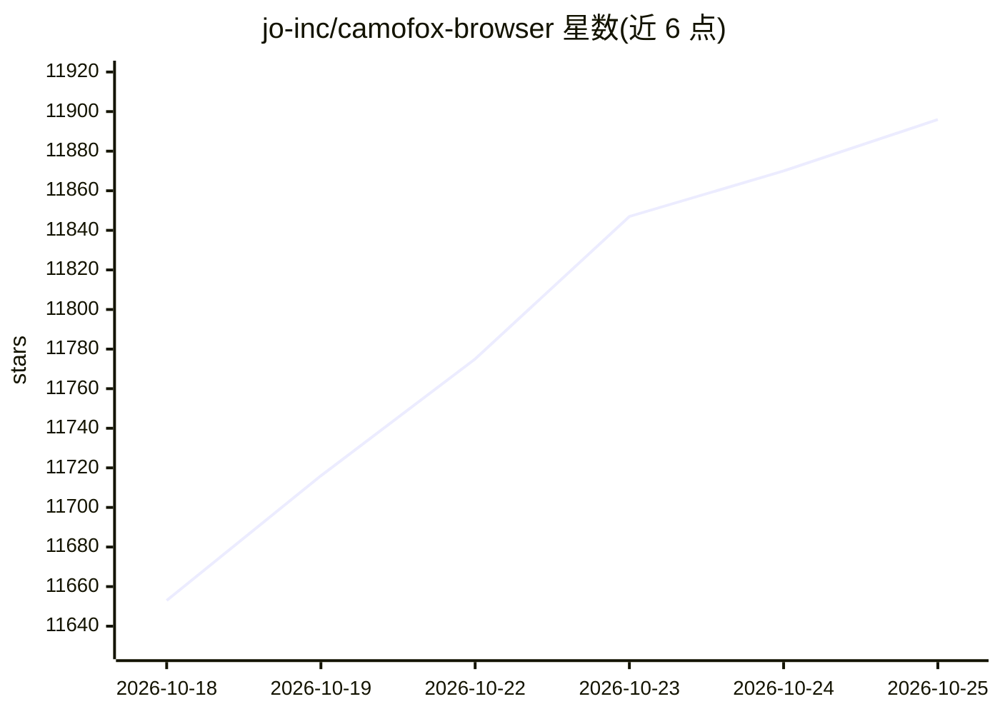

# jo-inc/camofox-browser

⭐ 11,896 · JavaScript · MIT · 推送 2026-10-23 · [GitHub](https://github.com/jo-inc/camofox-browser) · [官网](https://github.com/jo-inc/camofox-browser#readme) · 组织维护

**面向 AI agent 的反检测无头浏览器服务器，基于 Camoufox**

由 jo 团队维护的 Node.js 浏览器服务器：封装 Camoufox（C++ 层指纹伪装的 Firefox 分支），以 REST API 供 AI agent 浏览真实网页，绕过 Cloudflare 等 bot 检测。提供无障碍快照（比原始 HTML 约小 90%）、稳定元素引用、搜索宏、Cookie 导入、会话隔离与持久化、noVNC 可视化登录、Playwright trace、YouTube 字幕提取等功能；支持 OpenClaw 插件、npx、源码与 Docker/Fly.io/Railway 部署，首次运行下载约 300MB Camoufox 二进制。

## 筛选速览

| 维度 | 判定 | 备注 |
|---|---|---|
| AI 角色 | `ai-ecosystem` | LLM/agent 周边工具 |
| 许可风险 | `permissive` | MIT |
| 部署形态 | `desktop` | 安装包/桌面程序 |
| 模型依赖 | — | README 未给出锁定关系 |
| 硬件要求 | — | 无带数字的原话,不猜 |
| 安装摩擦 | `low` | 无编译、无系统依赖或容器化 |
| 成熟度 | — | 结构信号不足 |

## 能力要点

- C++ 层指纹伪装（WebGL/AudioContext/WebRTC 等）反检测
- 无障碍快照替代 HTML，附稳定元素引用供点击交互
- Netscape Cookie 导入、会话持久化、noVNC 可视化登录
- 提供 OpenClaw 插件与 Docker/Fly.io/Railway 部署方式

## 适用场景

- 让 AI agent 访问有 bot 检测的网站并稳定交互
- 导入已有浏览器 Cookie 实现登录态下的自动化浏览
- 在低配机器（树莓派/小型 VPS）上常驻运行浏览器服务

## 场景标签

`浏览器自动化` `网页抓取` · 领域:效率与自动化

## 证据(README 行号)

> L3:  Anti-detection browser server for AI agents, powered by Camoufox
> L34: This project wraps that engine in a REST API built for agents: accessibility snapshots instead of bloated HTML, sta

## 星数曲线

2026-10-18 11,653 → 2026-10-25 11,896（+243）

---
*卡片 v1 · prompt 1.4 · 生成 2026-10-20 · 置信度 mid · 依据 README sha `6cca0b7deb57` · [字段定义](../../DATASET.md)*
