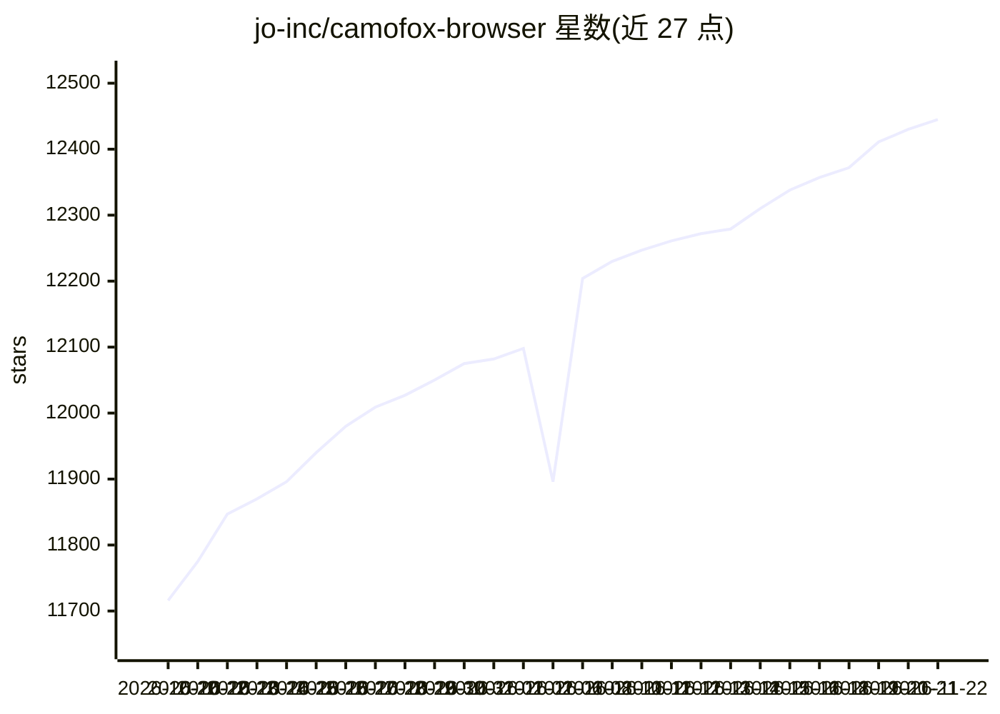

# jo-inc/camofox-browser

⭐ 12,445 · JavaScript · MIT · 推送 2026-11-10 · [GitHub](https://github.com/jo-inc/camofox-browser) · [官网](https://github.com/jo-inc/camofox-browser#readme) · 组织维护

**给 AI agent 用的反检测无头浏览器 REST 服务**

基于 Camoufox（C++ 层修改指纹的 Firefox 分支）封装的浏览器服务器，通过 REST API 与 MCP/OpenClaw 工具（共 31 个）供 agent 调用：返回 accessibility 快照与稳定元素引用以减少 token 消耗，支持 cookie 导入、会话隔离与持久化、代理 + GeoIP、YouTube 字幕提取、结构化抽取、VNC 交互登录等。以 npm 包/源码/Docker 部署，也可装为 OpenClaw 插件；首次启动下载约 300MB 的 Camoufox 二进制。

## 筛选速览

| 维度 | 判定 | 备注 |
|---|---|---|
| AI 角色 | `ai-ecosystem` | LLM/agent 周边工具 |
| 许可风险 | `permissive` | MIT |
| 部署形态 | `desktop` | 安装包/桌面程序 |
| 模型依赖 | — | README 未给出锁定关系 |
| 硬件要求 | — | 无带数字的原话,不猜 |
| 安装摩擦 | `low` | 无编译、无系统依赖或容器化 |
| 成熟度 | — | 结构信号不足 |

## 能力要点

- 基于 Camoufox 在 C++ 层伪装浏览器指纹（WebGL、WebRTC、屏幕几何等）
- 面向 agent 的 REST API 与 31 个 MCP/OpenClaw 工具，含 HTTP↔工具一致性测试门
- accessibility 快照比原始 HTML 小约 90%，提供稳定元素 ref
- 支持 Docker、Fly.io、Railway 部署，空闲内存约 40MB

## 适用场景

- 让 AI agent 自动浏览被 Cloudflare 等反爬机制拦截的网站
- 导入浏览器 cookie 让 agent 以已登录状态抓取 LinkedIn、Amazon 等站点
- 以低成本 VPS/Raspberry Pi 部署共享给多用户的浏览器服务

## 场景标签

`浏览器自动化` `网页抓取` · 领域:效率与自动化

## 证据(README 行号)

> L3:  Anti-detection browser server for AI agents, powered by Camoufox
> L34: This project wraps that engine in a REST API built for agents: accessibility snapshots instead of bloated HTML, sta
> L76: **Full HTTP ↔ agent-tool parity.** Every browser action Camofox exposes over HTTP is also a first-class MCP / OpenC

## 星数曲线

2026-10-20 11,716 → 2026-11-22 12,445（+729）

---
*卡片 v1 · prompt 1.4 · 生成 2026-11-22 · 置信度 mid · 依据 README sha `d4c3679d2ab7` · [字段定义](../../DATASET.md)*
