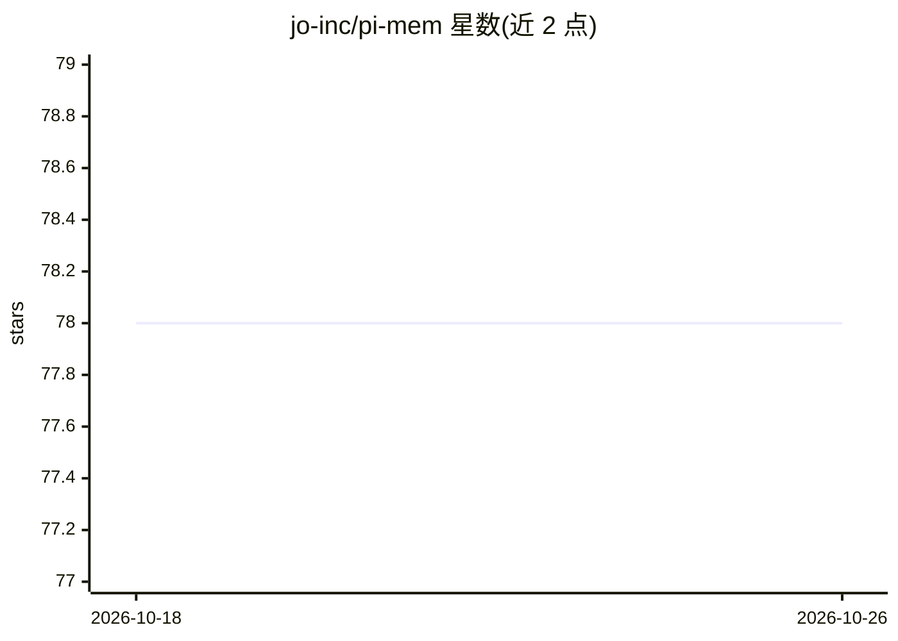

# jo-inc/pi-mem

⭐ 78 · TypeScript · MIT · 推送 2026-07-21 · [GitHub](https://github.com/jo-inc/pi-mem) · [官网](https://www.npmjs.com/package/@jo-inc/pi-mem) · 个人维护

**为 AI 编程 agent 提供纯 Markdown 持久记忆的工具**

面向 pi 编程 agent 的记忆扩展：在 ~/.pi/agent/memory/ 下用 Markdown 文件维护长期记忆（MEMORY.md）、每日追加日志、临时清单（SCRATCHPAD.md）与 LLM 自建笔记；提供 memory_write/memory_read/memory_search/scratchpad 四个工具，并在每轮对话前自动将部分文件注入系统提示。README 中检索为大小写不敏感的关键词搜索（描述中称支持语义搜索），未给出其实现细节。另含基于 LLM 分组的 24 小时活动摘要部件与 git 自动提交选项。

## 筛选速览

| 维度 | 判定 | 备注 |
|---|---|---|
| AI 角色 | `ai-ecosystem` | LLM/agent 周边工具 |
| 许可风险 | `permissive` | MIT |
| 部署形态 | `None` |  |
| 模型依赖 | — | README 未给出锁定关系 |
| 硬件要求 | — | 无带数字的原话,不猜 |
| 安装摩擦 | `low` | 无编译、无系统依赖或容器化 |
| 成熟度 | — | 结构信号不足 |

## 能力要点

- 四个记忆工具：写入/读取/关键词搜索/清单管理
- MEMORY.md、SCRATCHPAD.md、今日与昨日日志自动注入系统提示
- notes/ 与更早日志按需检索、不占用上下文
- 可选写入后自动 git 提交与 LLM 分组的 24h 摘要部件

## 适用场景

- 让我的编程 agent 跨会话记住决策与偏好
- 查看 agent 最近 24 小时做了什么、花了多少
- 用清单跟踪待修复事项并在会话间保留

## 场景标签

`Agent 记忆` · 领域:Agent 开发

## 证据(README 行号)

> L30: |`memory_write`|Write to `long_term` (MEMORY.md), `daily` (today's log), or `note` (notes/filename). Supports `appe
> L37: The following are automatically injected into the system prompt before every agent turn:

## 星数曲线

2026-10-18 78 → 2026-10-26 78（+0）

---
*卡片 v1 · prompt 1.4 · 生成 2026-10-24 · 置信度 high · 依据 README sha `650ccf2f2f60` · [字段定义](../../DATASET.md)*
