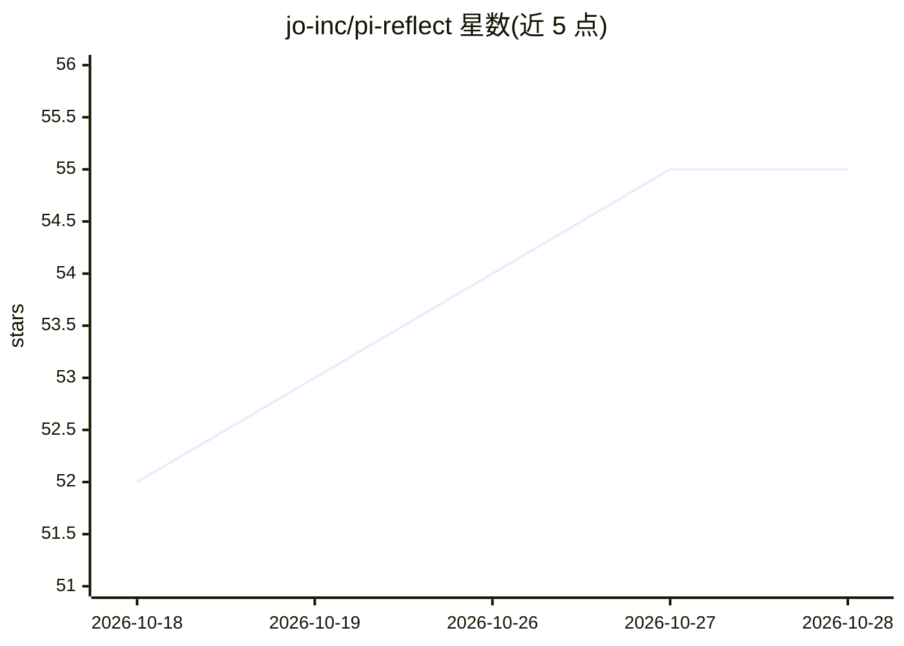

# jo-inc/pi-reflect

⭐ 55 · TypeScript · MIT · 推送 2026-10-11 · [GitHub](https://github.com/jo-inc/pi-reflect) · [官网](https://www.npmjs.com/package/@jo-inc/pi-reflect) · 组织维护

**pi 编码 agent 的行为文件自我改进扩展**

面向 pi 编码 agent 的 TypeScript 扩展：读取会话转录、日志与参考资料等证据，连同目标 markdown 文件（AGENTS.md/MEMORY.md/SOUL.md）发送给 LLM，由 LLM 找出实际行为与目标的差距并提出编辑；编辑带备份、跳过模糊匹配、拒绝可疑大段删除并自动 git 提交留痕。每次运行一次 LLM 调用（Sonnet 约 $0.05–0.15），需已配置 API key 的 pi。数据源支持文件、shell 命令与 HTTP GET，并提供纠正率与规则复发等指标追踪。

## 筛选速览

| 维度 | 判定 | 备注 |
|---|---|---|
| AI 角色 | `ai-ecosystem` | LLM/agent 周边工具 |
| 许可风险 | `permissive` | MIT |
| 部署形态 | `library` | 以包/库形式分发 |
| 模型依赖 | — | README 未给出锁定关系 |
| 硬件要求 | — | 无带数字的原话,不猜 |
| 安装摩擦 | `low` | 无编译、无系统依赖或容器化 |
| 成熟度 | — | 结构信号不足 |

## 能力要点

- 基于会话转录对行为/记忆/人格 markdown 文件做迭代编辑
- 编辑安全机制：备份、跳过模糊匹配、拒绝可疑大删除、自动 git 提交
- 数据源支持 files/command/url 三类 ContextSource
- /reflect-stats 追踪纠正率趋势与规则复发

## 适用场景

- 让编码 agent 把反复被纠正的行为固化为规则
- 从会话中提取持久事实维护长期记忆文件
- 按时间趋势检验 agent 是否已收敛、哪些规则未生效

## 场景标签

`Agent 记忆` · 领域:Agent 开发

## 证据(README 行号)

> L8: Iterative self-improvement for pi coding agents.
> L39: 1. Collects evidence: conversation transcripts, daily logs, reference files — from any combination of sources
> L40: 2. Sends the evidence + the target file + a prompt describing the desired end state to an LLM

## 星数曲线

2026-10-18 52 → 2026-10-28 55（+3）

---
*卡片 v1 · prompt 1.4 · 生成 2026-10-24 · 置信度 mid · 依据 README sha `1c5c9ccf2ce8` · [字段定义](../../DATASET.md)*
