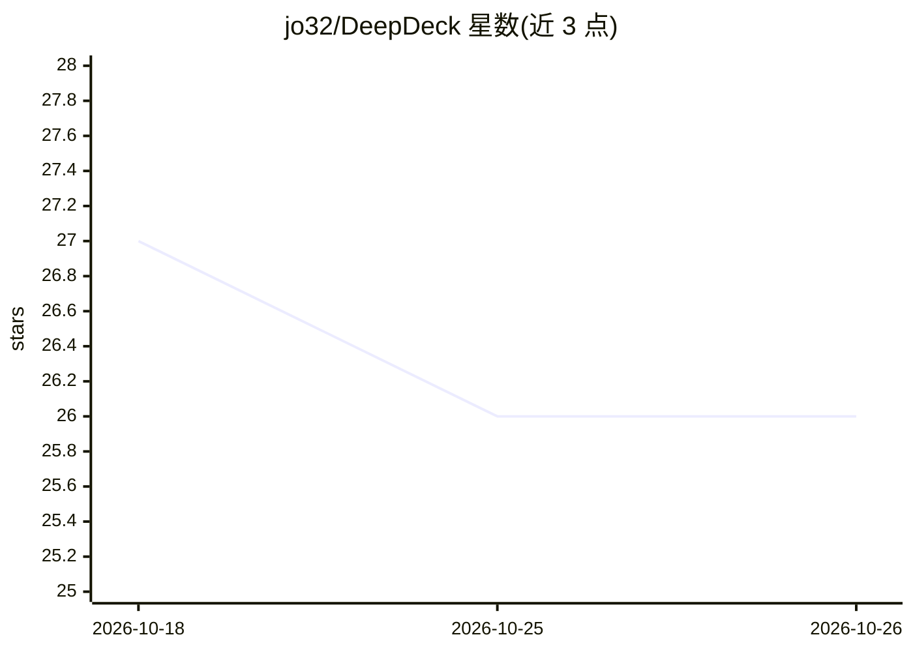

# jo32/DeepDeck

⭐ 26 · TypeScript · MIT · 推送 2026-10-17 · [GitHub](https://github.com/jo32/DeepDeck) · [官网](https://deepdeck.getmegaportal.com/) · 个人维护

**macOS 桌面端 DeepSeek Harness 工作台：构建复用网站 WebMCP 工具**

基于 DeepSeek Harness（pin 0.2.1-rc.2 子模块）的 macOS 桌面客户端：内嵌原生浏览器，Agent 可发现网站已有 WebMCP 工具直接调用；网站缺少工具时由 Builder 探索真实站点、验证操作并保存为可复用的 WebMCP 工具，支持检查、禁用与回滚。同时保留 Harness 的 profile、模型设置与插件市场（dshfind），提供 Bun Builder 编译本地插件与自动更新。需注意：工具初始构建消耗时间与 token，节省效果未测定；Apple Silicon/Intel 提供 DMG 下载。

## 筛选速览

| 维度 | 判定 | 备注 |
|---|---|---|
| AI 角色 | `ai-ecosystem` | LLM/agent 周边工具 |
| 许可风险 | `permissive` | MIT |
| 部署形态 | `library` | 以包/库形式分发 |
| 模型依赖 | locked-api |  |
| 硬件要求 | — | 无带数字的原话,不猜 |
| 安装摩擦 | `low` | 无编译、无系统依赖或容器化 |
| 成熟度 | `idea` | |

## 能力要点

- 发现并复用网站已有 WebMCP 工具，或由 Builder 生成新工具
- 生成的工具可检查、禁用、回滚，按网站保存并再次加载
- 兼容 Harness profile、模型设置、凭据与插件（dshfind 市场 + Bun Builder）
- Electron 打包，带原生更新器与签名发布流程

## 适用场景

- 让 Agent 调用网站的 WebMCP 工具完成搜索、读取、编辑草稿等任务
- 为没有 WebMCP 的网站构建并沉淀可复用工具
- 在桌面端管理 DeepSeek Harness 插件与设置

## 场景标签

`浏览器自动化` · 领域:效率与自动化

## 证据(README 行号)

> L5:  Build and reuse WebMCP tools in a macOS desktop workspace for DeepSeek Harness.
> L92: DeepDeck is a native-feeling desktop client built on DeepSeek Harness. The upstream project is pinned to **0.2.1-rc
> L94: DeepDeck reuses the official `web` profile and its complete plugin-composed UI. The desktop host starts the Harness

## 星数曲线

2026-10-18 27 → 2026-10-26 26（-1）

---
*卡片 v1 · prompt 1.4 · 生成 2026-10-26 · 置信度 high · 依据 README sha `b3c27d10c0c2` · [字段定义](../../DATASET.md)*
