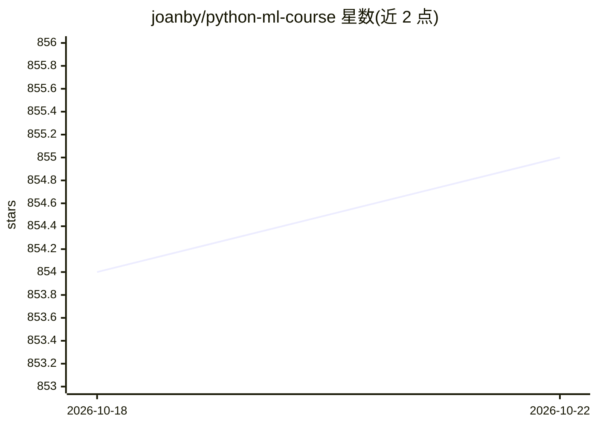

# joanby/python-ml-course

⭐ 855 · Jupyter Notebook · MIT · 推送 2026-10-14 · [GitHub](https://github.com/joanby/python-ml-course) · [官网](https://www.udemy.com/course/machinelearningpython/) · 个人维护

**西语 Python 机器学习入门课程配套代码仓库**

由 Juan Gabriel Gomila 设计的机器学习课程（西语）的代码仓库，内容覆盖 Python 环境安装、数据预处理与清洗、统计学复习、线性/多项式回归、逻辑回归与交叉验证、聚类、决策树与随机森林、SVM、KNN、PCA/LDA 降维、深度学习与强化学习（TensorFlow）。课程包含练习题与真实场景数据集，GitHub 提供全部 Python 源码。2026 年更新分支 update-2026 将 notebook 适配 pandas 3、NumPy 2、scikit-learn 1.9 与 TensorFlow 2，并说明主分支部分 notebook 在当前版本下报错。面向无经验到中级的学习者、程序员与数据分析师。

## 筛选速览

| 维度 | 判定 | 备注 |
|---|---|---|
| AI 角色 | `ai-knowledge` | 知识聚合/清单类 |
| 许可风险 | `permissive` | MIT |
| 部署形态 | `None` |  |
| 模型依赖 | — | README 未给出锁定关系 |
| 硬件要求 | — | 无带数字的原话,不猜 |
| 安装摩擦 | `low` | 无编译、无系统依赖或容器化 |
| 成熟度 | — | 结构信号不足 |

## 能力要点

- 13 个部分的课程结构，从环境安装到深度学习与强化学习
- 提供练习题与真实场景练习数据集
- update-2026 分支适配 pandas 3 / NumPy 2 / scikit-learn 1.9 / TensorFlow 2
- 全部课程 Python 源码可下载

## 适用场景

- 跟着西语课程系统学习 Python 机器学习
- 获取涵盖回归、分类、聚类、SVM、PCA 等主题的示例代码与数据集
- 复习统计学基础并实践经典机器学习算法

## 场景标签

`教程课程` · 领域:学习与行业

## 证据(README 行号)

> L1: # Curso completo de Machine Learning: Data Science en Python
> L17: - Parte 1 - Instalación de Python y paquetes necesarios para data science, machine learning y visualización de los 
> L29: - Parte 13 - Deep learning, Reinforcement Learning, Redes neuronales artificiales y convolucionales y Tensor Flow

## 星数曲线

2026-10-18 854 → 2026-10-22 855（+1）

---
*卡片 v1 · prompt 1.4 · 生成 2026-10-21 · 置信度 high · 依据 README sha `4f0a4aa3f15f` · [字段定义](../../DATASET.md)*
