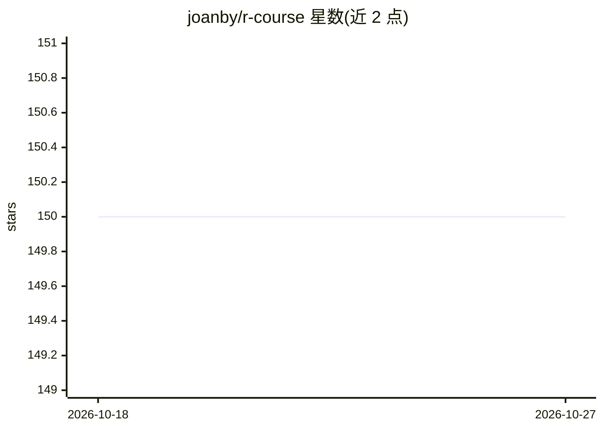

# joanby/r-course

⭐ 150 · Java · MIT · 推送 2026-10-14 · [GitHub](https://github.com/joanby/r-course) · [官网](https://www.udemy.com/r-data-science/?couponCode=GIT_JB) · 个人维护

**R 数据分析入门到进阶的课程配套代码仓库（西语）**

讲师 Juan Gabriel Gomila 的 R 与 RStudio 数据分析课程配套仓库，以 13 个主题覆盖数据获取与预处理、探索性分析、分类（朴素贝叶斯/KNN/SVM/神经网络）、回归、聚类与主成分分析、时间序列、推荐系统、社交网络分析、可视化、报告生成与地理空间分析。2026 年新增 update-2026 分支将代码适配 R 4.5 并替换已从 CRAN 下架的包。完整视频课程（50+ 小时）在 Udemy 付费获取。

## 筛选速览

| 维度 | 判定 | 备注 |
|---|---|---|
| AI 角色 | `ai-knowledge` | 知识聚合/清单类 |
| 许可风险 | `permissive` | MIT |
| 部署形态 | `None` |  |
| 模型依赖 | — | README 未给出锁定关系 |
| 硬件要求 | — | 无带数字的原话,不猜 |
| 安装摩擦 | `low` | 无编译、无系统依赖或容器化 |
| 成熟度 | — | 结构信号不足 |

## 能力要点

- 13 个主题覆盖分类、回归、聚类、时间序列、推荐系统、社交网络分析
- update-2026 分支适配 R 4.5 并替换已下架的 maptools/rgdal/dummies
- 使用 ggplot2、plyr、R Markdown 等常用 R 包

## 适用场景

- 跟随课程系统学习 R 数据分析技术
- 查找各数据分析技术在 R 中的实现示例代码
- 了解旧版 R 课程代码向 R 4.5 迁移的变化

## 场景标签

`教程课程` · 领域:学习与行业

## 证据(README 行号)

> L1: # Curso completo de análisis de datos con R: de cero a experto con JB
> L7: Una introduccion al analisis de datos con R y R Studio.
> L60: Y recuerda que el curso completo con mas de 50 horas de contenido en video grabado por el profesor Juan Gabriel Gom

## 星数曲线

2026-10-18 150 → 2026-10-27 150（+0）

---
*卡片 v1 · prompt 1.4 · 生成 2026-10-22 · 置信度 high · 依据 README sha `e20018f803c1` · [字段定义](../../DATASET.md)*
