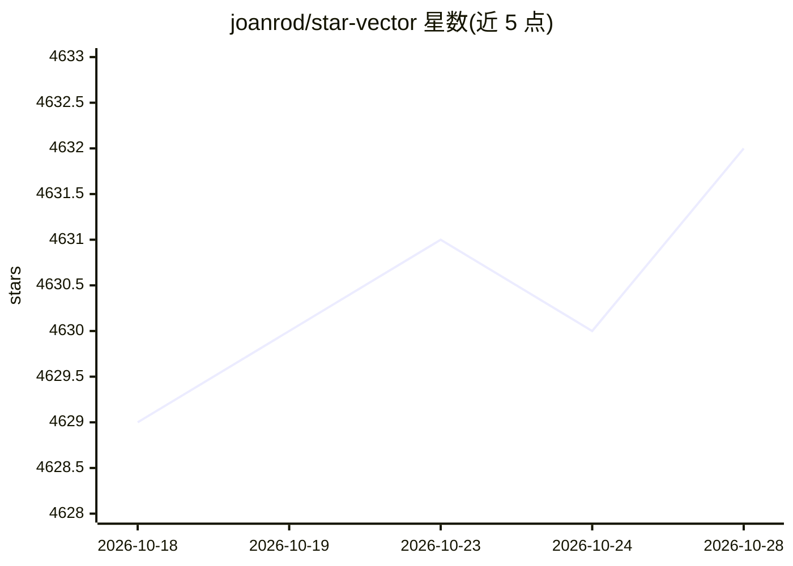

# joanrod/star-vector

⭐ 4,632 · Python · Apache-2.0 · 推送 2025-11-07 · [GitHub](https://github.com/joanrod/star-vector) · [官网](https://starvector.github.io) · 组织维护

**把图像与文本转为 SVG 代码的多模态视觉语言基础模型**

StarVector 是面向可缩放矢量图形（SVG）生成的多模态视觉语言模型，将图像矢量化建模为代码生成任务：图像被投影为视觉 token 后由基于 StarCoder 的 LLM 生成 SVG 代码，也支持仅凭文本指令的 Text2SVG。提供 1B 与 8B 两档 HuggingFace 权重、200 万样本训练集 SVG-Stack 与评测基准 SVG-Bench，以及 Python API、Gradio 网页演示和训练/评测脚本。README 声明模型不适用于自然图像与插画，适用范围为图标、logo、技术图表、图形与图表的矢量化。

## 筛选速览

| 维度 | 判定 | 备注 |
|---|---|---|
| AI 角色 | `ai-native` | 本体是模型或模型工具 |
| 许可风险 | `permissive` | Apache-2.0 |
| 部署形态 | `library` | 以包/库形式分发 |
| 模型依赖 | local-ok | 支持本地模型 |
| 硬件要求 | — | 无带数字的原话,不猜 |
| 安装摩擦 | `low` | 无编译、无系统依赖或容器化 |
| 成熟度 | — | 结构信号不足 |

## 能力要点

- Image2SVG 与 Text2SVG 两种生成任务，LLM 基于 StarCoder
- 提供 1B/8B HuggingFace 模型权重
- 配套 SVG-Stack（2.1M 样本）训练集与 SVG-Bench（10 数据集、3 任务）评测基准
- 提供 Gradio 网页演示与 HuggingFace/vLLM 双推理后端

## 适用场景

- 把图标、logo 等图像矢量化为 SVG 代码
- 用文本指令生成 SVG 图形
- 在 SVG-Bench 上评测 SVG 生成模型
- 基于开源权重与数据集复现或继续训练模型

## 场景标签

`代码生成` `多模态` · 领域:编码与开发

## 证据(README 行号)

> L42: StarVector is a multimodal vision-language model for Scalable Vector Graphics (SVG) generation. It can be used to p
> L50: StarVector uses a multimodal architecture to process images and text. When performing Image-to-SVG (or image vector
> L119: *Note*: StarVector models will not work for natural images or illustrations, as they have not been trained on thos

## 星数曲线

2026-10-18 4,629 → 2026-10-28 4,632（+3）

---
*卡片 v1 · prompt 1.4 · 生成 2026-10-20 · 置信度 high · 依据 README sha `c625c590bbdf` · [字段定义](../../DATASET.md)*
