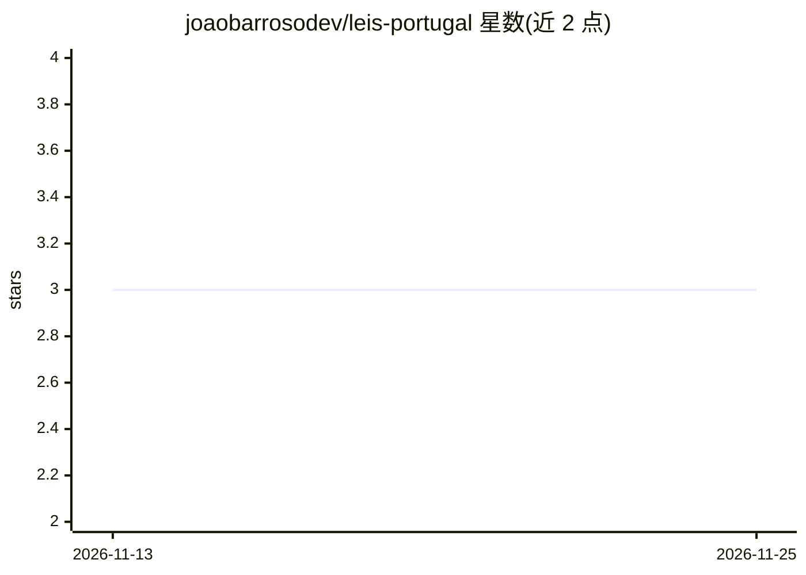

# joaobarrosodev/leis-portugal

⭐ 3 · MIT · 推送 2026-11-24 · [GitHub](https://github.com/joaobarrosodev/leis-portugal) · 个人维护

**葡萄牙法律法规开放数据仓库，面向公众与 AI 应用**

以开放格式汇集葡萄牙法律文本的开源仓库：收录约 46 万条记录，含 1833 年以来《共和国公报》第一系列全国立法、约 3.1 万条亚速尔与马德拉地区法规、约 5.4 万条欧盟法规，以及 CNPD 决定、宪法法院判决等，均附官方来源链接与版本历史。数据每日通过 GitHub Actions 更新，可导出为 JSONL、SQLite、Parquet；另有一个带 reranker 的法律问答原型和 Mac/Windows 桌面应用。

## 筛选速览

| 维度 | 判定 | 备注 |
|---|---|---|
| AI 角色 | `ai-knowledge` | 知识聚合/清单类 |
| 许可风险 | `permissive` | MIT |
| 部署形态 | `library` | 以包/库形式分发 |
| 模型依赖 | — | README 未给出锁定关系 |
| 硬件要求 | — | 无带数字的原话,不猜 |
| 安装摩擦 | `low` | 无编译、无系统依赖或容器化 |
| 成熟度 | `idea` | |

## 能力要点

- 约 46 万条法律记录，含版本历史与 104 万条法律关系
- 每日更新，支持导出 JSONL、SQLite、Parquet
- 问答原型基于检索文章生成回答，无依据时回答'不知道'
- 提供 Mac/Windows 桌面应用与浏览器页面两种使用方式

## 适用场景

- 检索并复用葡萄牙法律法规的结构化文本
- 为搜索引擎或 AI 应用提供法律语料
- 查询某项法律在特定日期的生效文本

## 场景标签

`RAG` `文档问答` · 领域:知识与检索

## 证据(README 行号)

> L7: O `leis-portugal` é um projeto open-source que pretende reunir e organizar legislação portuguesa num repositório púb
> L17: |Registos|~460 mil: ~375 mil da legislação nacional (1.ª Série desde 1833, praticamente completa face aos sitemaps 
> L26: |Perguntas (protótipo)|Pesquisa por artigo com reranker e resposta só a partir dos artigos encontrados, com "não se

## 星数曲线

2026-11-13 3 → 2026-11-25 3（+0）

---
*卡片 v1 · prompt 1.4 · 生成 2026-11-21 · 置信度 mid · 依据 README sha `79e7d698a3a8` · [字段定义](../../DATASET.md)*
