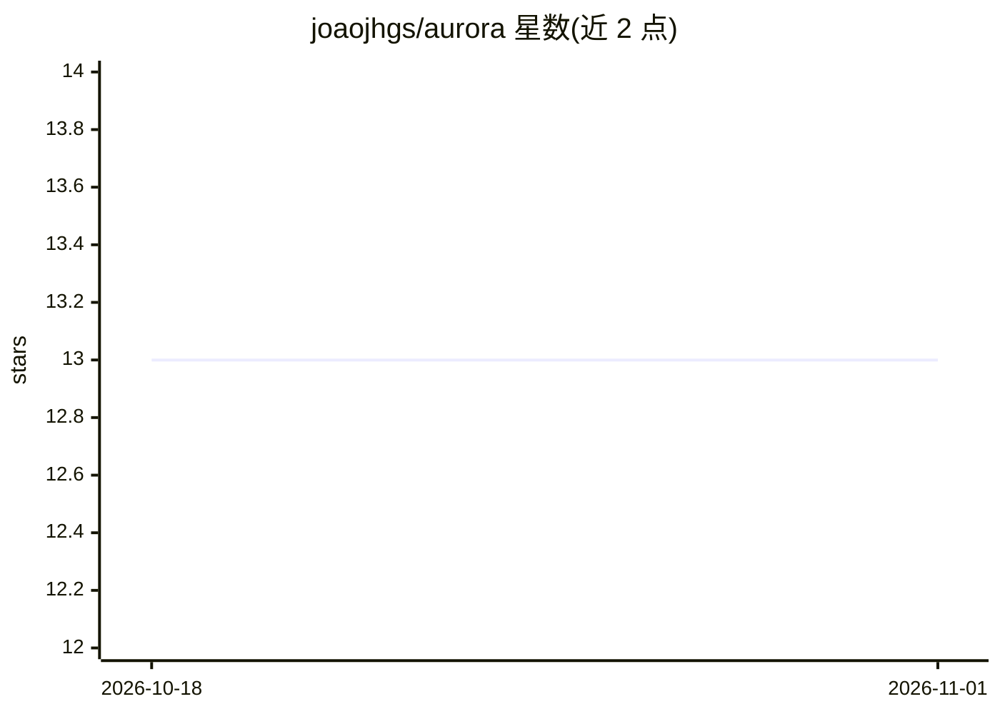

# joaojhgs/aurora

⭐ 13 · TypeScript · MIT · 推送 2026-10-22 · [GitHub](https://github.com/joaojhgs/aurora) · 个人维护

**可私有部署的模块化语音助手与自动化平台**

Aurora 是一个可在本地节点、自托管服务器或浏览器/桌面/Android/iOS 客户端运行的模块化语音与自动化平台。Python 服务提供语音（wakeword、STT/TTS）、基于 LangGraph/LangChain 的 LLM 编排（支持 OpenAI、Hugging Face、llama.cpp 等配置）、自动化工具、SQLite 存储、调度、认证与 mesh 连接；TypeScript SDK 与共享 React UI 跨端复用。提供发布版安装脚本、引导安装、uv 源码安装、Docker Compose 进程模式及 Tauri 桌面/移动客户端打包。项目声明处于活跃开发中，Android/iOS 物理设备验证仍在推进。

## 筛选速览

| 维度 | 判定 | 备注 |
|---|---|---|
| AI 角色 | `ai-native` | 本体是模型或模型工具 |
| 许可风险 | `permissive` | MIT |
| 部署形态 | `desktop` | 安装包/桌面程序 |
| 模型依赖 | — | README 未给出锁定关系 |
| 硬件要求 | — | 无带数字的原话,不猜 |
| 安装摩擦 | `low` | 无编译、无系统依赖或容器化 |
| 成熟度 | `idea` | |

## 能力要点

- 语音链路覆盖 wakeword、STT、push-to-talk、TTS 与流式回答
- LangGraph/LangChain 编排，支持 OpenAI、Hugging Face、llama.cpp 等模型配置
- 多形态部署：本地节点、托管 Web UI、Tauri 桌面（local/client）、Android/iOS 客户端
- Gateway 认证/权限/配对与 mesh 对等连接

## 适用场景

- 在家中或工作站自建隐私优先的语音助手节点
- 通过浏览器、桌面或手机客户端远程访问自己的 Aurora 节点
- 以单进程或 Docker+Redis 容器模式部署私有助理服务

## 场景标签

`语音 Agent` `AI 助手` · 领域:对话与助手

## 证据(README 行号)

> L13: Aurora is a modular voice and automation platform that can run as a private local node, a multi-service server, or 
> L33: - **Voice:** wakeword, coordinated speech-to-text, push-to-talk, text-to-speech, and streaming assistant responses.
> L34: - **Assistant orchestration:** LangGraph/LangChain workflows with OpenAI, Hugging Face, and llama.cpp-oriented prof

## 星数曲线

2026-10-18 13 → 2026-11-01 13（+0）

---
*卡片 v1 · prompt 1.4 · 生成 2026-10-31 · 置信度 high · 依据 README sha `3e558a9abb29` · [字段定义](../../DATASET.md)*
