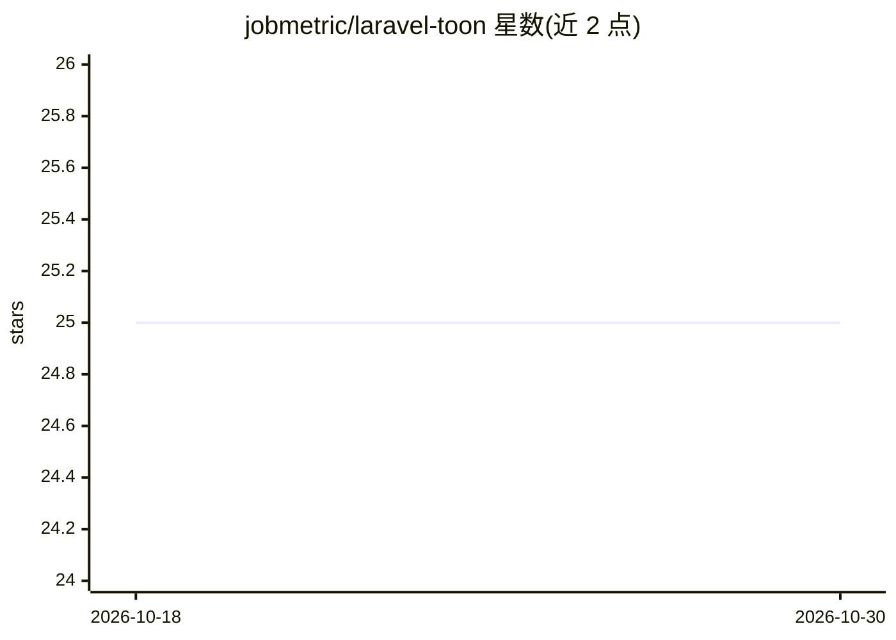

# jobmetric/laravel-toon

⭐ 25 · PHP · MIT · 推送 2025-12-27 · [GitHub](https://github.com/jobmetric/laravel-toon) · [官网](https://packagist.org/packages/jobmetric/laravel-toon) · 个人维护

**Laravel 包：将 JSON 编解码为面向 LLM 的 TOON 紧凑格式**

为 Laravel 提供 TOON 格式的集成：把 JSON 数据编码为 token 优化的紧凑表示，或反向解码回 PHP 数据。机制包括符合规范的表头（如 [3]: 1,2,3）、统一对象列表的智能表格化编码、可选的安全键折叠（单键链折叠为点路径）与解码路径展开、严格缩进与行数校验、可配置错误处理。以 Facade、全局辅助函数与容器单例三种 API 提供，通过 Composer 安装，要求 PHP>=8.0.1 与 Laravel>=9.19。

## 筛选速览

| 维度 | 判定 | 备注 |
|---|---|---|
| AI 角色 | `ai-ecosystem` | LLM/agent 周边工具 |
| 许可风险 | `permissive` | MIT |
| 部署形态 | `None` |  |
| 模型依赖 | — | README 未给出锁定关系 |
| 硬件要求 | — | 无带数字的原话,不猜 |
| 安装摩擦 | `low` | 无编译、无系统依赖或容器化 |
| 成熟度 | — | 结构信号不足 |

## 能力要点

- 规范符合的 TOON 编码/解码，含非默认分隔符表头（[3|]、[2\t]）
- 统一对象列表自动检测并输出紧凑表格块
- 可选安全键折叠（key_folding='safe'）与解码路径展开（expand_paths）
- 提供 Facade、全局辅助函数 toon_encode/toon_decode 与 DI 单例三种 API

## 适用场景

- Laravel 应用在构造 LLM 提示词前压缩 JSON 数据以节省 token
- 处理 LLM 返回的 TOON 格式数据并还原为 PHP 数组
- 对大数字或结构化数据做可控的字符串化解码

## 场景标签

 · 领域:Web 开发/LLM 数据格式

## 证据(README 行号)

> L9: Laravel integration for TOON format: encode/decode JSON data into a token‑optimized notation for LLMs. This package 
> L53:  - Human‑readable and token‑efficient (ideal for LLM prompts)

## 星数曲线

2026-10-18 25 → 2026-10-30 25（+0）

---
*卡片 v1 · prompt 1.4 · 生成 2026-10-27 · 置信度 high · 依据 README sha `6f2691bd76dd` · [字段定义](../../DATASET.md)*
