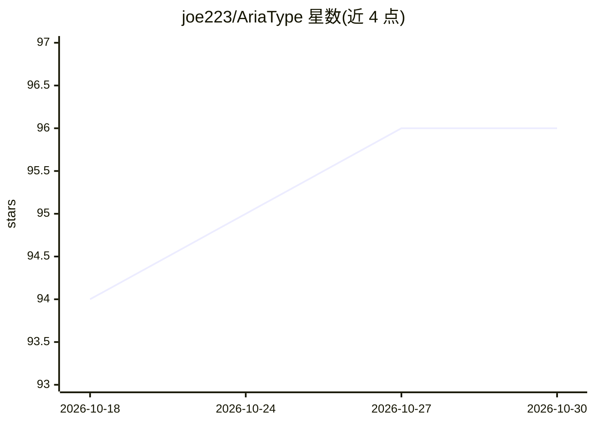

# joe223/AriaType

⭐ 96 · Rust · AGPL-3.0 · 推送 2026-10-10 · [GitHub](https://github.com/joe223/AriaType) · [官网](https://ariatype.com) · 个人维护 · 中文 README

**桌面端语音输入与写作工具：说话即成文，落在光标处**

面向桌面用户的语音输入层：在任意应用中按住快捷键说话，文本直接插入当前光标位置；支持 VAD 停顿检测、降噪、上下文感知（读取当前窗口语境）、本地或云端 AI 润色（去口头冗余、修标点）、词级纠错记忆与拼音热词词库、本地模型管理、流式润色与历史记录。默认本地优先、无需账号、不上传语音，可按需接入自有云端服务。多语言覆盖中英日韩。macOS 12.0+（Apple Silicon 与 Intel）可安装使用，Windows 版开发中；从 GitHub Releases 或官网下载安装。AGPL-3.0 许可。

## 筛选速览

| 维度 | 判定 | 备注 |
|---|---|---|
| AI 角色 | `ai-native` | 本体是模型或模型工具 |
| 许可风险 | `viral` | AGPL-3.0 |
| 部署形态 | `None` |  |
| 模型依赖 | — | README 未给出锁定关系 |
| 硬件要求 | — | 无带数字的原话,不猜 |
| 安装摩擦 | `low` | 无编译、无系统依赖或容器化 |
| 成熟度 | `idea` | |

## 能力要点

- 光标处直接插入文本，无需切换窗口或复制粘贴
- 本地优先：默认语音留在设备上，云端服务为可选接入
- 本地/云端 AI 润色，内置聊天回复、正式写作等模板并支持自定义
- 词级纠错记忆与拼音/别名声近热词，确定性修正先于 AI 润色

## 适用场景

- 在聊天、邮件和协作工具中用语音快速回复
- 口述笔记和草稿，事后由 AI 润色整理
- 口述 Agent Prompt 与操作指令
- 中文等多语言场景下的日常语音输入，数据留在本地

## 场景标签

`语音识别` `AI 写作` · 领域:内容生成

## 证据(README 行号)

> L7:  AriaType is the voice layer for your desktop, turning spoken thoughts into context-aware work right where your curs
> L47: - ✍️ **Local and cloud AI polish / 本地和云端 AI 润色**
> L65: - ☁️ **Cloud STT and custom providers / 云端识别与自定义服务**

## 星数曲线

2026-10-18 94 → 2026-10-30 96（+2）

---
*卡片 v1 · prompt 1.4 · 生成 2026-10-24 · 置信度 high · 依据 README sha `e19638e441bf` · [字段定义](../../DATASET.md)*
