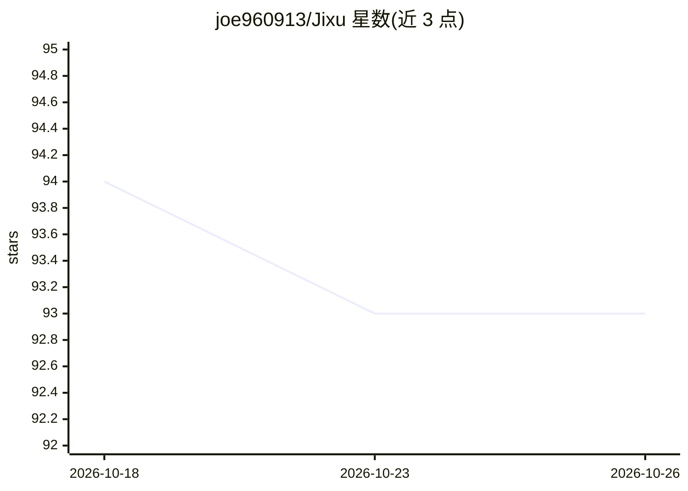

# joe960913/Jixu

⭐ 93 · TypeScript · MIT · 推送 2026-09-30 · [GitHub](https://github.com/joe960913/Jixu) · [官网](https://jixu.dev) · 个人维护 · 中文 README

**TypeScript 单 Agent 可恢复运行框架：持久化 Thread 与原生 TUI**

面向 TypeScript 开发者的单 Agent Harness 框架：核心 API 为 createHarness/createThread/thread.send，将执行记录为有序 Events，由纯 Reducer 派生 State、显式 Effect 经 Driver 执行外部工作，从而支持 Thread 的恢复、Replay、Fork 与上下文压缩（Continuity Handoff）。附带渐进式 Skills、Event-backed Plan、工具审批策略，以及可安装的原生 TUI（macOS arm64 / Linux x64）。提供 jixu-core、jixu-llm（OpenAI/Anthropic Drivers）、JSONL/SQLite Store 等分包。pre-1.0，API 可能变化；明确声明不是多 Agent 编排器或工作流引擎，Bash Tool 无 OS 沙箱。

## 筛选速览

| 维度 | 判定 | 备注 |
|---|---|---|
| AI 角色 | `ai-ecosystem` | LLM/agent 周边工具 |
| 许可风险 | `permissive` | MIT |
| 部署形态 | `library` | 以包/库形式分发 |
| 模型依赖 | — | README 未给出锁定关系 |
| 硬件要求 | — | 无带数字的原话,不猜 |
| 安装摩擦 | `low` | 无编译、无系统依赖或容器化 |
| 成熟度 | `idea` | |

## 能力要点

- durable Event → Reducer → Effect → Driver 单一执行路径，支持恢复/Replay/Fork
- 上下文预算与压缩：Context Manifest 记录选材依据，Continuity Handoff 保留源链接
- 渐进式 Skills：按需激活、参与 Context 预算，TUI 提供本地管理器
- Provider 中立的模型 Drivers（OpenAI Chat Completions / Anthropic Messages）与 JSONL/SQLite Event Store

## 适用场景

- 构建可在中断后安全续跑的单 Agent 应用
- 需要可审计执行历史与确定性 Replay 的 Agent 开发
- 在终端通过 TUI 使用带 Skills 与工具审批的参考 Agent

## 场景标签

`Agent 框架` · 领域:Agent 开发

## 证据(README 行号)

> L7: A small single-Agent Harness for TypeScript. Define one Agent, give it Tools
> L10: The core API stays small: `createHarness`, `createThread`, and `thread.send`.
> L54: The TUI uses the same public Agent, Harness, Thread, Store, and Driver APIs as

## 星数曲线

2026-10-18 94 → 2026-10-26 93（-1）

---
*卡片 v1 · prompt 1.4 · 生成 2026-10-24 · 置信度 high · 依据 README sha `10697f46a4bf` · [字段定义](../../DATASET.md)*
