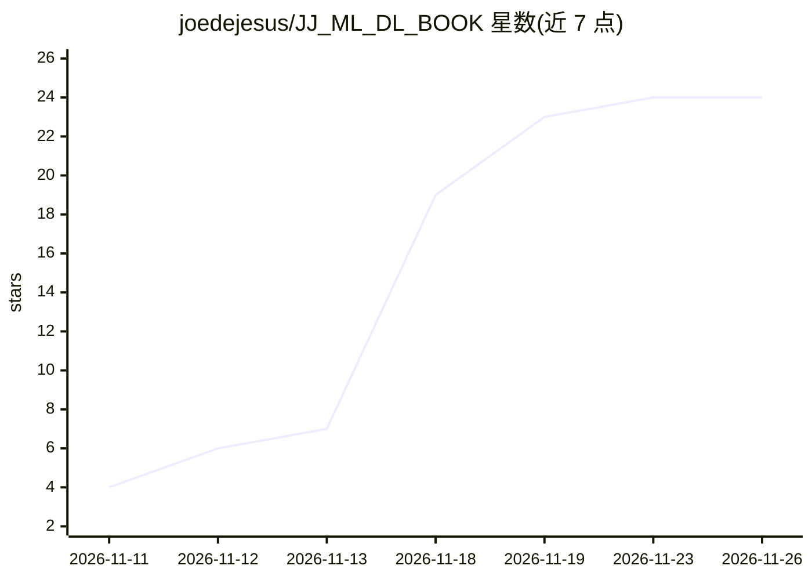

# joedejesus/JJ_ML_DL_BOOK

⭐ 24 · Jupyter Notebook · NOASSERTION · 推送 2026-11-10 · [GitHub](https://github.com/joedejesus/JJ_ML_DL_BOOK) · [官网](https://github.com/joedejesus/JJ_ML_DL_BOOK) · 个人维护

**西班牙语数据科学与机器学习实践教程书（143 个 Jupyter 笔记本）**

面向西班牙语初学者的实践型电子书：以 4 个阶段、35 个主题组织数学基础、机器学习、深度学习（PyTorch）与 NLP/Transformers（Hugging Face），包含 143 个可执行 Jupyter 笔记本、4 个最终项目（客户流失、信用违约、工业图像缺陷检测、工单分类）和一个实验笔记本。使用方式为下载仓库、创建 Python 虚拟环境、安装 requirements.txt 固定版本依赖后在 VS Code 或 Jupyter 中运行。README 明确声明为非商业教育用途，项目数据为小型合成数据，结果不可用于生产或实际决策。

## 筛选速览

| 维度 | 判定 | 备注 |
|---|---|---|
| AI 角色 | `ai-knowledge` | 知识聚合/清单类 |
| 许可风险 | `none` | NOASSERTION |
| 部署形态 | `desktop` | 安装包/桌面程序 |
| 模型依赖 | — | README 未给出锁定关系 |
| 硬件要求 | — | 无带数字的原话,不猜 |
| 安装摩擦 | `low` | 无编译、无系统依赖或容器化 |
| 成熟度 | — | 结构信号不足 |

## 能力要点

- 4 阶段 35 主题共 143 个按序组织的 Jupyter 笔记本
- 4 个最终项目各带独立文档并明示结果局限
- 依赖版本固定于 requirements.txt，提供 Windows/macOS/Linux 环境搭建脚本与说明
- 覆盖 PyTorch 训练、CNN/RNN、Transformers、Hugging Face 微调与推理

## 适用场景

- 零基础系统学习从数学基础到 NLP/Transformers 的完整路径
- 有经验者按主题或项目直接复习特定内容
- 教师在免费课程中展示和讲解教学示例

## 场景标签

`教程课程` · 领域:学习与行业

## 证据(README 行号)

> L3: **JJ ML DL BOOK** es un libro práctico en español sobre ciencia de datos, machine learning, deep learning y procesam
> L16: **4 fases** · **35 temas** · **4 proyectos finales** · **143 notebooks**, incluido un cuaderno de laboratorio.

## 星数曲线

2026-11-11 4 → 2026-11-26 24（+20）

---
*卡片 v1 · prompt 1.4 · 生成 2026-11-18 · 置信度 high · 依据 README sha `ba2cf54a9684` · [字段定义](../../DATASET.md)*
