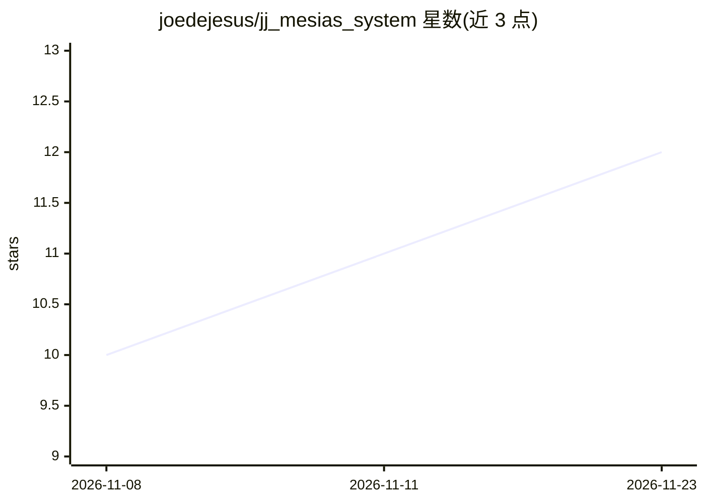

# joedejesus/jj_mesias_system

⭐ 12 · Python · NOASSERTION · 推送 2026-11-05 · [GitHub](https://github.com/joedejesus/jj_mesias_system) · [官网](https://github.com/joedejesus/jj_mesias_system) · 个人维护

**本地 Python AI 助手工程：推理、记忆、API、界面与 LoRA 训练一体化**

面向学习与实验的本地 AI 助手系统：以 Transformers/PyTorch 加载本地 Hugging Face 模型（验证引擎为 Qwen2.5-3B-Instruct），同一核心通过 CLI、FastAPI 与 Gradio 三种界面暴露；包含按说话人持久化的会话记忆、仅限 HTTPS 的网页上下文抓取与域名可信度优先级，以及与日常运行时分离的 LoRA 训练脚本。README 建议至少 32 GB 内存，环境验证仅覆盖 Windows + venv，需手动下载模型文件放入 src/modelo。仓库声明专有许可，不接受外部 PR。

## 筛选速览

| 维度 | 判定 | 备注 |
|---|---|---|
| AI 角色 | `ai-native` | 本体是模型或模型工具 |
| 许可风险 | `none` | NOASSERTION |
| 部署形态 | `desktop` | 安装包/桌面程序 |
| 模型依赖 | — | README 未给出锁定关系 |
| 硬件要求 | — | 无带数字的原话,不猜 |
| 安装摩擦 | `low` | 无编译、无系统依赖或容器化 |
| 成熟度 | — | 结构信号不足 |

## 能力要点

- 同一功能核心暴露为 CLI、FastAPI API 与 Gradio 界面
- 按说话人持久化的会话记忆与历史
- 仅接受 HTTPS 的网页上下文检索，含可信域名优先级与显式失败策略
- LoRA 训练管线与日常运行时分离（tools/train_lora_seguro.py）

## 适用场景

- 在本地搭建一个可阅读可修改的 AI 助手学习项目
- 练习模型推理、记忆、API 与界面的端到端集成
- 在本地对开源模型做小规模 LoRA 微调实验

## 场景标签

`AI 助手` `微调` `Agent 记忆` · 领域:Agent 开发

## 证据(README 行号)

> L16: Mesias es un asistente local en Python orientado a inferencia, memoria conversacional simple, contexto web seguro p
> L104: - inferencia local integrada con Transformers, PyTorch y artefactos de Hugging Face
> L105: - exposición del mismo núcleo funcional por CLI, FastAPI y Gradio

## 星数曲线

2026-11-08 10 → 2026-11-23 12（+2）

---
*卡片 v1 · prompt 1.4 · 生成 2026-11-18 · 置信度 high · 依据 README sha `56c191989a37` · [字段定义](../../DATASET.md)*
