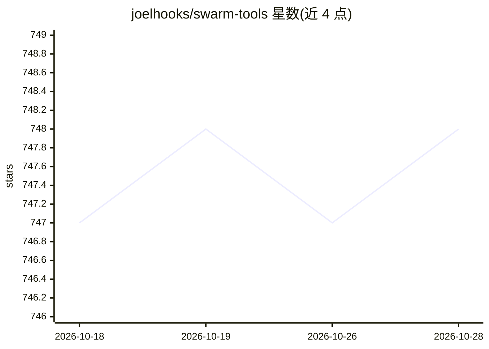

# joelhooks/swarm-tools

⭐ 748 · TypeScript · 推送 2026-07-30 · [GitHub](https://github.com/joelhooks/swarm-tools) · [官网](https://swarmtools.ai) · 个人维护

**面向 OpenCode/Claude Code 的多 agent 协调插件：任务分解、并行执行与经验学习**

以 npm 插件形式安装到 OpenCode 与 Claude Code 的多 agent 协调工具：通过 /swarm 命令将任务分解为子任务，在 Hive（git 版本化任务追踪）中创建 cell，派生带文件独占锁的 worker 并行工作，经 Swarm Mail（actor 模型消息与事件溯源）协调，完成后审查并记录学习。Hivemind 提供 Ollama 嵌入的语义记忆（可回退到全文检索），本地运行，无外部服务器。必需依赖 Bun，Ollama 为可选。

## 筛选速览

| 维度 | 判定 | 备注 |
|---|---|---|
| AI 角色 | `ai-ecosystem` | LLM/agent 周边工具 |
| 许可风险 | `none` | — |
| 部署形态 | `library` | 以包/库形式分发 |
| 模型依赖 | local-ok | 支持本地模型 |
| 硬件要求 | — | 无带数字的原话,不猜 |
| 安装摩擦 | `low` | 无编译、无系统依赖或容器化 |
| 成熟度 | — | 结构信号不足 |

## 能力要点

- 任务自动分解为子任务并派生带文件预留的并行 worker
- Hive：git 版本化的任务追踪，跨会话保留
- Hivemind：基于 Ollama 嵌入的语义记忆，可回退 FTS
- 事件溯源架构：libSQL 嵌入式存储 + 学习系统（模式成熟/反模式自动生成/置信度衰减）

## 适用场景

- 在 OpenCode 或 Claude Code 中把大型编码任务拆分给多个 agent 并行处理
- 跨会话追踪 agent 任务状态与交接
- 积累项目经验供后续任务检索复用

## 场景标签

`多智能体` `编码 Agent` `Agent 记忆` · 领域:Agent 开发

## 证据(README 行号)

> L26: npm install -g opencode-swarm-plugin
> L64: /swarm "Add user authentication with OAuth"
> L138: - **Hivemind** - Semantic memory with Ollama embeddings (falls back to FTS)

## 星数曲线

2026-10-18 747 → 2026-10-28 748（+1）

---
*卡片 v1 · prompt 1.4 · 生成 2026-10-21 · 置信度 high · 依据 README sha `ac993674da6a` · [字段定义](../../DATASET.md)*
