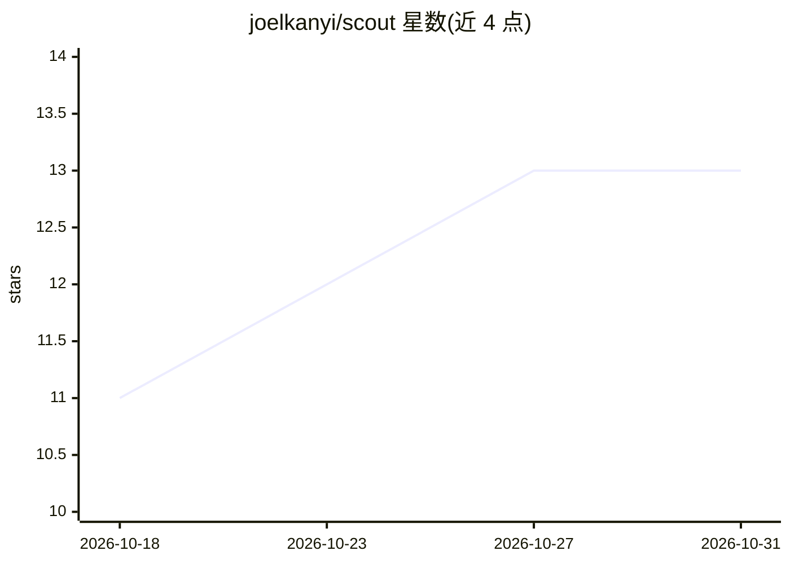

# joelkanyi/scout

⭐ 13 · Python · MIT · 推送 2026-09-08 · [GitHub](https://github.com/joelkanyi/scout) · [官网](https://github.com/joelkanyi/scout#readme) · 个人维护

**本地运行的自动求职平台：抓取职位、AI 评分、定制简历、自动投递**

面向求职者的本地 CLI 工具加 Web 仪表盘：从 15+ 职位来源（Indeed、LinkedIn、Greenhouse 等）抓取职位，将职位描述与用户主简历一同发送给所选 AI 供应商，返回 0-100 匹配分、缺失技能与建议动作；随后生成针对该职位的 PDF/DOCX 简历与求职信，并支持 Greenhouse/Lever/Workday 表单的自动填写与提交，附带捏造检测器对比主简历。AI 供应商可选 Gemini、Ollama（本地）、Anthropic 或任意 OpenAI 兼容 API（含 Qwen/DashScope、DeepSeek）。医疗与教育类职位的自动投递被禁用，需人工核验。提供安装脚本与 Docker 两种部署方式，要求 Mac 或 Linux。

## 筛选速览

| 维度 | 判定 | 备注 |
|---|---|---|
| AI 角色 | `ai-native` | 本体是模型或模型工具 |
| 许可风险 | `permissive` | MIT |
| 部署形态 | `self-host` | docker 或自建部署 |
| 模型依赖 | local-ok | 支持本地模型 |
| 硬件要求 | — | 无带数字的原话,不猜 |
| 安装摩擦 | `low` | 无编译、无系统依赖或容器化 |
| 成熟度 | — | 结构信号不足 |

## 能力要点

- 从 15+ 职位来源抓取并按偏好过滤
- AI 匹配评分（0-100%）+ 缺失技能与 ATS 关键词分析
- 针对单个职位生成定制简历（PDF/DOCX）与求职信，带捏造检测器
- 支持 Greenhouse/Lever/Workday 自动投递，后台守护进程定时抓取/评分/邮件同步

## 适用场景

- 批量抓取并按匹配度筛选目标职位
- 为每次投递生成贴合职位描述的简历和求职信
- 自动填写并提交申请表单，同时追踪申请状态与无回复提醒

## 场景标签

`浏览器自动化` `网页抓取` `AI 写作` · 领域:效率与自动化

## 证据(README 行号)

> L5: Scout finds jobs from 15+ sources, scores them against your profile using AI, tailors your resume for each applicati
> L149: This sends each unscored job to your AI provider to get a match score (0-100%) based on your resume and preference

## 星数曲线

2026-10-18 11 → 2026-10-31 13（+2）

---
*卡片 v1 · prompt 1.4 · 生成 2026-10-31 · 置信度 mid · 依据 README sha `271712c8d4da` · [字段定义](../../DATASET.md)*
