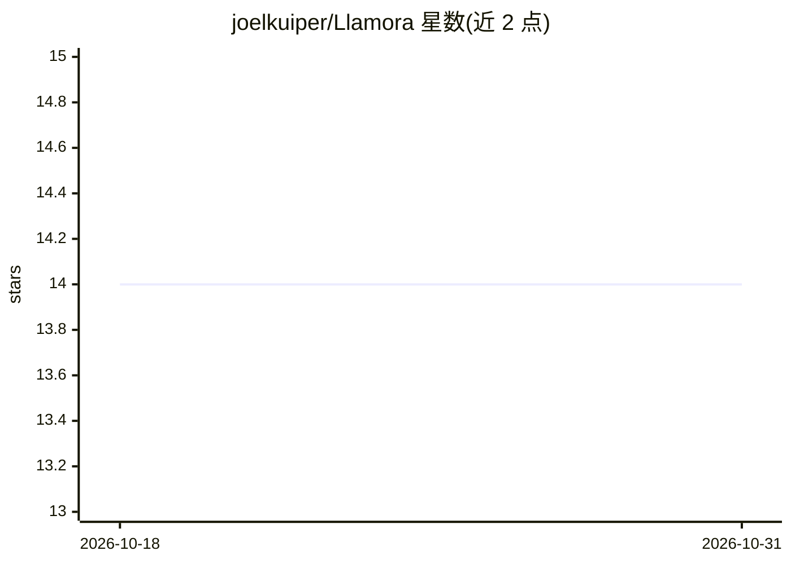

# joelkuiper/Llamora

⭐ 14 · Python · GPL-3.0 · 推送 2026-09-29 · [GitHub](https://github.com/joelkuiper/Llamora) · 个人维护

**本地优先的 AI 日记 Web 应用：模型生成本地回应与标签**

面向个人用户的日记 Web 应用，基于 Python(Quart)+HTMX+SQLite。用户在按日期组织的日记页书写，本机运行的 LLM（默认 llama.cpp，兼容任意 OpenAI 接口）生成每日开篇、对条目的回应及可保留的 'traces' 标签，并提供语义搜索与日历导航。所有内容（条目、嵌入、标签、图片）以 XChaCha20-Poly1305 在应用层加密后落库，密码经 Argon2ID 派生密钥解锁，明文不写盘；应用无外发请求与遥测。通过 uv 安装运行，需先启动 llama.cpp 服务；也可改用 OpenAI/Nous/OpenRouter 等外部 API。

## 筛选速览

| 维度 | 判定 | 备注 |
|---|---|---|
| AI 角色 | `ai-native` | 本体是模型或模型工具 |
| 许可风险 | `viral` | GPL-3.0 |
| 部署形态 | `library` | 以包/库形式分发 |
| 模型依赖 | local-ok | 支持本地模型 |
| 硬件要求 | — | 无带数字的原话,不猜 |
| 安装摩擦 | `low` | 无编译、无系统依赖或容器化 |
| 成熟度 | — | 结构信号不足 |

## 能力要点

- 模型生成本地开篇、回应与 traces 标签，条目与模型贡献累积于同一档案
- 全库加密：条目/嵌入/标签/图片均 XChaCha20-Poly1305 加密，支持 DEK 轮换与恢复码
- 语义搜索（bge-small-en-v1.5 + HNSWlib）与日历导航
- 推理兼容任意 OpenAI /v1/chat/completions 端点，默认 llama.cpp，无遥测外发

## 适用场景

- 写每日日记并由本机模型生成回应与标签
- 通过语义搜索和 traces 回看跨日期的 recurring 主题
- 隐私敏感场景下的本地加密日记存档

## 场景标签

`知识库管理` · 领域:知识与检索

## 证据(README 行号)

> L7: > Write in daily pages. A model running on your machine produces day openings, recaps, and reflective responses.
> L20: Many AI interfaces are built around an ongoing back-and-forth. Here, the model is part of a daily flow: it opens ea
> L32: - **Day openings** — the model generates a short opening each morning, drawing on recent entries and a digest of th

## 星数曲线

2026-10-18 14 → 2026-10-31 14（+0）

---
*卡片 v1 · prompt 1.4 · 生成 2026-10-31 · 置信度 mid · 依据 README sha `debd96abd9e2` · [字段定义](../../DATASET.md)*
