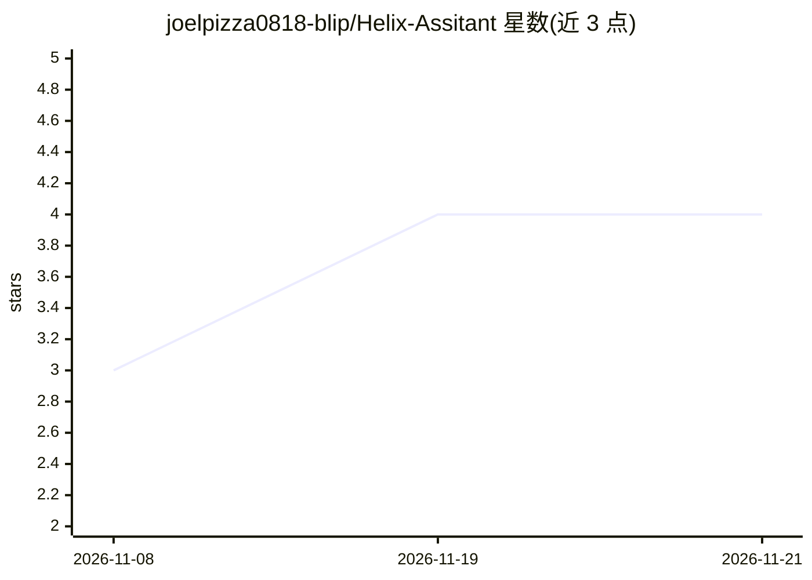

# joelpizza0818-blip/Helix-Assitant

⭐ — · [GitHub]() · 个人维护

**Windows 本地优先桌面 AI 助手，带权限确认与语音/屏幕上下文**

HELIX 是一个本地优先的桌面 agent，提供 Desktop（Electron）、Android 伴侣应用与 CLI 三种客户端；可请求桌面、终端、文件与浏览器任务，敏感操作按 READ_ONLY/CRITICAL 等分级执行可配置确认策略。支持配置云端 provider 或本地模型端点，带 provider key failover 池；通过 Markdown skills 与可选本地 MCP 服务器扩展。模型目录含 49 条配置项，覆盖 8 个 provider 标识；本地会话记忆与 CCL 压缩层处理大体积工具输出。

## 筛选速览

| 维度 | 判定 | 备注 |
|---|---|---|
| AI 角色 | `ai-native` | 本体是模型或模型工具 |
| 许可风险 | `permissive` | — |
| 部署形态 | `desktop` | 安装包/桌面程序 |
| 模型依赖 | local-ok | 支持本地模型 |
| 硬件要求 | — | 无带数字的原话,不猜 |
| 安装摩擦 | `low` | 无编译、无系统依赖或容器化 |
| 成熟度 | — | 结构信号不足 |

## 能力要点

- Desktop（Electron）、Android 与 CLI 三种客户端形态
- 工具操作分级（READ_ONLY 至 CRITICAL）并按策略要求人工确认
- 8 个 provider 标识共 49 条模型目录配置，含 ollama、llama_server 等本地端点
- Context Compression Layer：大输出以摘要+内容 ID 表示，原文 gzip 保留可检索

## 适用场景

- 让助手代为执行 Windows shell 命令与文件操作，敏感动作前人工确认
- 通过 CLI 在终端中连接并执行 agent 任务
- 在本地配置 Ollama 等端点作为模型后端
- 为桌面 agent 添加可审查的 Markdown skills 与 MCP 服务器

## 场景标签

`AI 助手` `GUI 自动化` · 领域:效率与自动化

## 证据(README 行号)

> L3: ### The Persistent, Local-First AI Desktop Assistant for Windows
> L5: HELIX is a local-first desktop agent that works with your operating system, terminal, and the context you choose to 
> L20: - **Choose an AI provider:** configure supported cloud providers or local model endpoints, with provider-key fallba
> L25: The repository catalog contains **49 entries** across 8 provider identifiers: `anthropic` (7), `free` (6), `google`

## 星数曲线

2026-11-08 3 → 2026-11-21 4（+1）

---
*卡片 v1 · prompt 1.4 · 生成 2026-11-21 · 置信度 high · 依据 README sha `2cefbf1a4d8e` · [字段定义](../../DATASET.md)*
