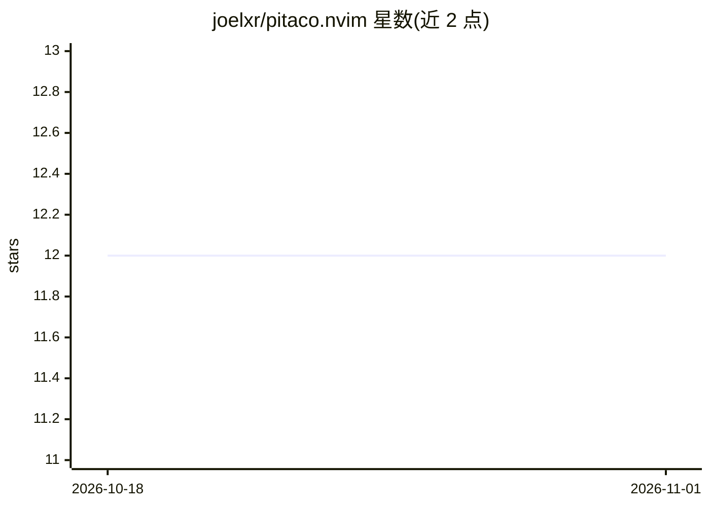

# joelxr/pitaco.nvim

⭐ 12 · Lua · 推送 2026-04-21 · [GitHub](https://github.com/joelxr/pitaco.nvim) · 个人维护

**Neovim 内的 AI 代码评审插件：评审 diff/文件、生成提交信息**

面向 Neovim 用户的 AI 代码评审插件：对分支 diff 或整文件发起评审并通过 Neovim diagnostics API 发布发现；本地索引器用 tree-sitter 解析 TS/JS/Lua/Go/Python 仓库、存语义分块到 .repo-pitaco/index，评审请求注入检索到的仓库上下文。另支持生成 commit message、markdown PR 摘要，按功能作用域切换 provider/model，评审历史持久化。可接 OpenAI/Anthropic/OpenRouter/Ollama/OpenCode，Ollama 无需 API key。自述为实验性插件。

## 筛选速览

| 维度 | 判定 | 备注 |
|---|---|---|
| AI 角色 | `ai-native` | 本体是模型或模型工具 |
| 许可风险 | `none` | — |
| 部署形态 | `library` | 以包/库形式分发 |
| 模型依赖 | local-ok | 支持本地模型 |
| 硬件要求 | — | 无带数字的原话,不猜 |
| 安装摩擦 | `low` | 无编译、无系统依赖或容器化 |
| 成熟度 | `idea` | |

## 能力要点

- diff/文件评审结果经 Neovim diagnostics API 发布并持久化
- 本地索引器用 tree-sitter 抽取语义分块，评审请求带仓库上下文
- 按 review/commit/summary 作用域独立选择 provider/model
- 支持 OpenAI/Anthropic/OpenRouter/Ollama/OpenCode 五种 provider

## 适用场景

- 提交前在编辑器内评审分支改动
- 让 AI 生成 commit message 和 PR 摘要
- 用本地 Ollama 模型离线评审代码

## 场景标签

`代码审查` · 领域:编码与开发

## 证据(README 行号)

> L3: Welcome to the **Pitaco** Neovim plugin! This is an experimental plugin designed to provide you with an AI reviewer 
> L7: - **Repository-aware reviews**: Review the current branch diff or the entire current file with `:Pitaco`, `:Pitaco r
> L43: - `:Pitaco` - Review the full branch diff and publish findings via the Neovim diagnostics API.

## 星数曲线

2026-10-18 12 → 2026-11-01 12（+0）

---
*卡片 v1 · prompt 1.4 · 生成 2026-11-01 · 置信度 high · 依据 README sha `649b2213fd8d` · [字段定义](../../DATASET.md)*
