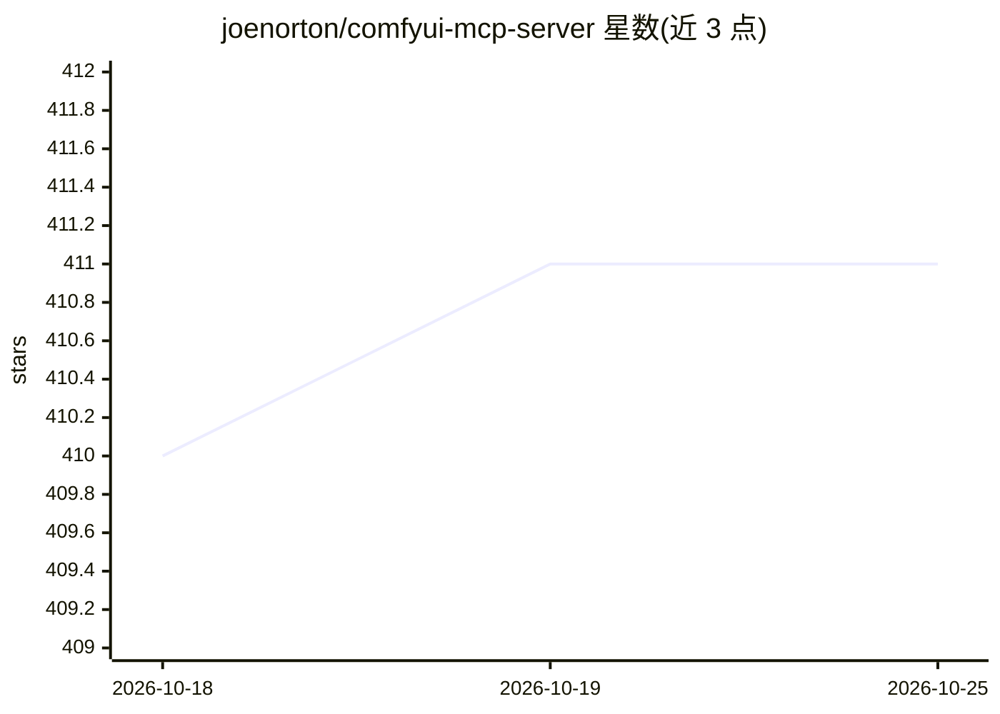

# joenorton/comfyui-mcp-server

⭐ 411 · Python · Apache-2.0 · 推送 2026-02-17 · [GitHub](https://github.com/joenorton/comfyui-mcp-server) · 个人维护

**让 AI agent 通过 MCP 调用本地 ComfyUI 生成图像音频视频的服务器**

基于 Python 的 MCP 服务器，向 AI 客户端（Cursor/Claude/n8n）暴露工具调用，委托本地 ComfyUI 实例生成图像、音频与视频。工具覆盖生成（generate_image/generate_song/regenerate）、任务轮询与取消、资产列表与元数据查询、参数默认值配置（运行时/配置文件/环境变量三级优先级）、自定义工作流自动发现（workflows/ 目录 JSON 文件转为工具）及资产发布到项目 web 目录。采用 streamable-http 传输，监听 127.0.0.1:9000/mcp。限制：资产注册表为临时性，asset_id 在重启或 TTL（默认 24 小时）后失效。

## 筛选速览

| 维度 | 判定 | 备注 |
|---|---|---|
| AI 角色 | `ai-ecosystem` | LLM/agent 周边工具 |
| 许可风险 | `permissive` | Apache-2.0 |
| 部署形态 | `library` | 以包/库形式分发 |
| 模型依赖 | — | README 未给出锁定关系 |
| 硬件要求 | — | 无带数字的原话,不猜 |
| 安装摩擦 | `low` | 无编译、无系统依赖或容器化 |
| 成熟度 | — | 结构信号不足 |

## 能力要点

- 委托本地 ComfyUI 生成图像/音频/视频，提供 regenerate 参数覆写式迭代
- workflows/ 目录 JSON 工作流自动发现并以 PARAM_* 占位符暴露参数
- 资产发布工具可压缩（默认 600KB 目标）并更新 manifest 到项目 web 目录
- 三级默认值配置：运行时 → 配置文件 → 环境变量

## 适用场景

- 在 Cursor/Claude 等 AI 客户端中用自然语言生成并迭代图片
- 把生成的图片发布到网站项目并更新 manifest
- 让 agent 轮询、取消长时生成的任务

## 场景标签

`图像生成` · 领域:内容生成

## 证据(README 行号)

> L5: A lightweight MCP (Model Context Protocol) server that lets AI agents generate and iteratively refine images, audio,
> L7: You run the server, connect a client, and issue tool calls. Everything else is optional depth.
> L115: - You still run a local MCP server that delegates execution to ComfyUI

## 星数曲线

2026-10-18 410 → 2026-10-25 411（+1）

---
*卡片 v1 · prompt 1.4 · 生成 2026-10-21 · 置信度 mid · 依据 README sha `9e5af4ea3cce` · [字段定义](../../DATASET.md)*
