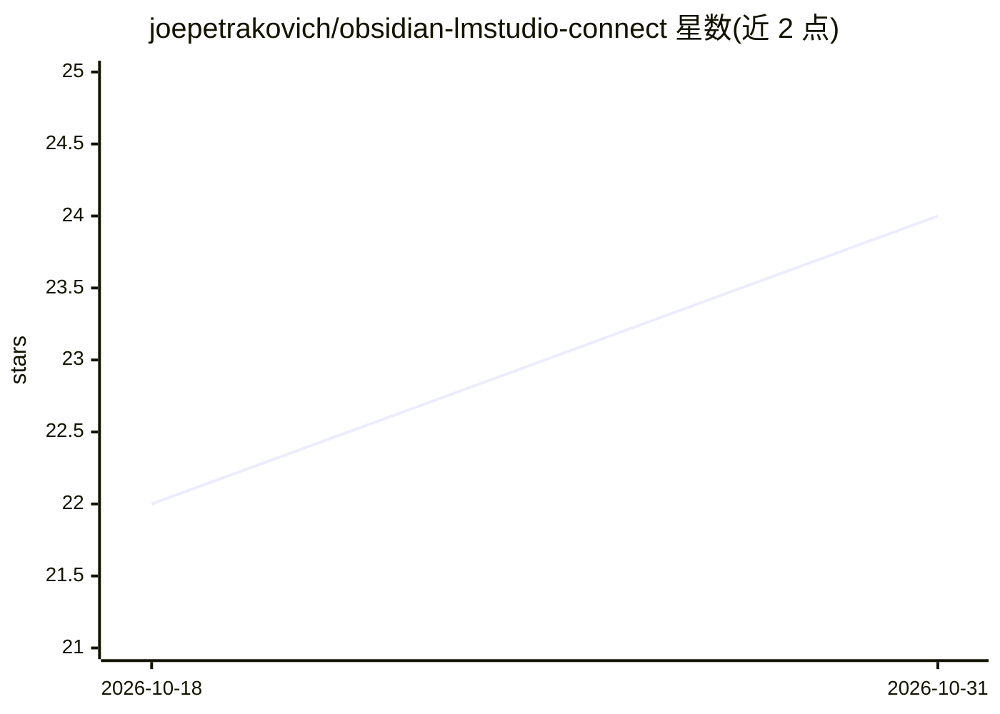

# joepetrakovich/obsidian-lmstudio-connect

⭐ 24 · TypeScript · MIT · 推送 2026-09-12 · [GitHub](https://github.com/joepetrakovich/obsidian-lmstudio-connect) · 个人维护

**连接 LM Studio 的 Obsidian AI 聊天与笔记问答插件**

Obsidian 插件，连接本地 LM Studio 服务端，提供 AI 聊天界面与围绕笔记库的只读 agent 工具。用户可通过 '[[' 引用笔记或直接提及当前打开的笔记进行对话；支持复用 LM Studio 中配置的 MCP 服务器（需在 LM Studio 开启相应权限与认证）；还支持在笔记中嵌入 lmsc 代码块形式的提示词。要求 LM Studio 服务端运行并启用 CORS 选项。作者声明与 LM Studio 官方公司无隶属关系。

## 筛选速览

| 维度 | 判定 | 备注 |
|---|---|---|
| AI 角色 | `ai-native` | 本体是模型或模型工具 |
| 许可风险 | `permissive` | MIT |
| 部署形态 | `None` |  |
| 模型依赖 | — | README 未给出锁定关系 |
| 硬件要求 | — | 无带数字的原话,不猜 |
| 安装摩擦 | `low` | 无编译、无系统依赖或容器化 |
| 成熟度 | — | 结构信号不足 |

## 能力要点

- 连接 LM Studio 实例的 AI 聊天界面
- 围绕笔记库的轻量只读 agent 工具
- 可复用 LM Studio 配置的 MCP 服务器
- lmsc 代码块嵌入提示词并可隐藏工具调用/推理输出

## 适用场景

- 在 Obsidian 中与本地 LLM 私密、离线地对话
- 让 LLM 基于我的笔记内容回答问题
- 在笔记中嵌入提示词块直接调用 LLM

## 场景标签

`聊天机器人` `文档问答` · 领域:对话与助手

## 证据(README 行号)

> L11: An Obsidian plugin that provides an AI chat interface to an LM Studio instance and a lightweight read-only agent ha
> L17: - Ensure you have LM Studio set up and that the server is running **with the CORS option enabled**.

## 星数曲线

2026-10-18 22 → 2026-10-31 24（+2）

---
*卡片 v1 · prompt 1.4 · 生成 2026-10-27 · 置信度 high · 依据 README sha `9ef43c63ee00` · [字段定义](../../DATASET.md)*
