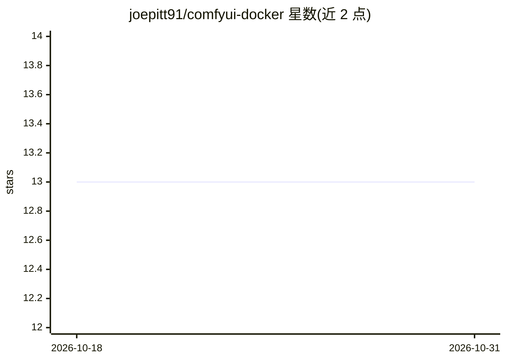

# joepitt91/comfyui-docker

⭐ 13 · Dockerfile · GPL-3.0 · 推送 2026-10-16 · [GitHub](https://github.com/joepitt91/comfyui-docker) · 个人维护

**ComfyUI 容器镜像：以 Docker 跑 ComfyUI，支持 CPU/AMD/Intel/NVIDIA**

提供 ComfyUI 的易用容器镜像与 docker compose 部署方式，覆盖 CPU、AMD、Intel Arc、NVIDIA 四类硬件；AMD 镜像因依赖体积（约 23GB）须本地构建。通过 compose 文件启动，模型等用户内容复制进持久化 content 卷；支持 HTTPS 证书挂载、网络访问配置、环境变量定制（注意力优化、VRAM 配置、多用户存储等）及可选启用 ComfyUI-Manager。面向已具备 Docker 主机的用户。

## 筛选速览

| 维度 | 判定 | 备注 |
|---|---|---|
| AI 角色 | `ai-ecosystem` | LLM/agent 周边工具 |
| 许可风险 | `viral` | GPL-3.0 |
| 部署形态 | `self-host` | docker 或自建部署 |
| 模型依赖 | — | README 未给出锁定关系 |
| 硬件要求 | `cpu-ok` | |
| 安装摩擦 | `low` | 无编译、无系统依赖或容器化 |
| 成熟度 | — | 结构信号不足 |

## 能力要点

- cpu/intel/nvidia 预构建标签，AMD 需本地构建（依赖约 23GB）
- 环境变量定制注意力实现、VRAM 配置与多用户存储
- content/tls/tmp 三个卷管理用户内容、HTTPS 证书与临时文件
- 可选启用 ComfyUI-Manager

## 适用场景

- 在 Docker 主机上一条命令部署 ComfyUI
- 为不同 GPU（NVIDIA/Intel Arc/AMD）选择对应镜像标签运行
- 通过容器持久化卷管理模型与输出文件

## 场景标签

`图像生成` · 领域:内容生成

## 证据(README 行号)

> L1: # ComfyUI Docker Images
> L3: Easy to use container images of ComfyUI, supporting use in CPU only mode (slow) and with AMD, Intel

## 星数曲线

2026-10-18 13 → 2026-10-31 13（+0）

---
*卡片 v1 · prompt 1.4 · 生成 2026-10-31 · 置信度 high · 依据 README sha `2449c6dcd034` · [字段定义](../../DATASET.md)*
