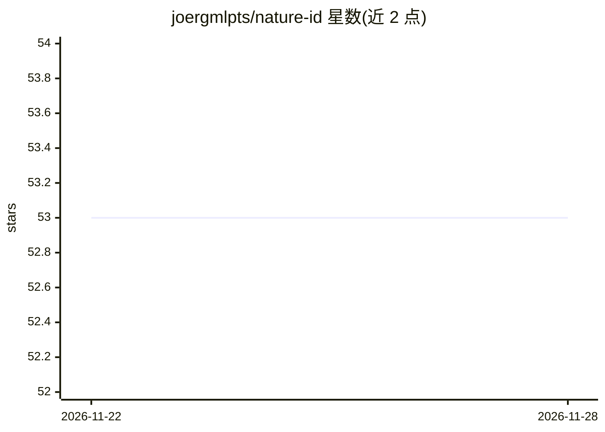

# joergmlpts/nature-id

⭐ 53 · Python · MIT · 推送 2026-11-22 · [GitHub](https://github.com/joergmlpts/nature-id) · 个人维护

**对照片中的植物、鸟类和昆虫做物种识别的命令行工具**

基于 Google 用 iNaturalist 数据训练的三个分类模型（植物/鸟类/昆虫），通过 TensorFlow Lite 运行推理，输出跨分类阶元的概率得分；无法确定到种时可给出属、科、目等更高级阶元的结果。用户通过阈值控制鉴定精度，支持显示全部俗名、仅学名、平铺标签列表等输出选项。首次运行会加载约百万条目的 iNaturalist 分类树并与标签对齐，结果缓存到磁盘；查不到的名称会经 iNaturalist API 限速查询。

## 筛选速览

| 维度 | 判定 | 备注 |
|---|---|---|
| AI 角色 | `ai-native` | 本体是模型或模型工具 |
| 许可风险 | `permissive` | MIT |
| 部署形态 | `library` | 以包/库形式分发 |
| 模型依赖 | — | README 未给出锁定关系 |
| 硬件要求 | — | 无带数字的原话,不猜 |
| 安装摩擦 | `low` | 无编译、无系统依赖或容器化 |
| 成熟度 | — | 结构信号不足 |

## 能力要点

- 植物/鸟类/昆虫三个 iNat 训练的 TFLite 分类模型
- 跨分类阶元得分计算，阈值控制鉴定的阶元级别
- 自动同步 iNaturalist 最新分类树与俗名（约 100 万分类单元）
- 首次计算分类层级后缓存，后续调用直接加载

## 适用场景

- 批量识别本地照片库中的植物、鸟类和昆虫
- 物种鉴定失败时获取属/科/目级别的可靠结果
- 实验 Seek 式的分类阶元阈值打分方法

## 场景标签

`目标检测` · 领域:感知与多模态

## 证据(README 行号)

> L3: This repository provides Python code that identifies plants, birds, and insects in photos.
> L9: This code is based on the trained models provided by Google. It was written to experiment with identifying species f
> L15: This is a command-line tool. It is invoked with images or directories containing images and identifies the plants, 

## 星数曲线

2026-11-22 53 → 2026-11-28 53（+0）

---
*卡片 v1 · prompt 1.4 · 生成 2026-11-22 · 置信度 mid · 依据 README sha `a0667888a9ba` · [字段定义](../../DATASET.md)*
