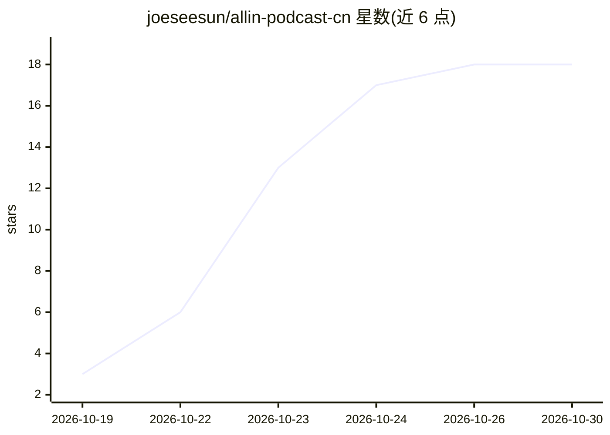

# joeseesun/allin-podcast-cn

⭐ 18 · HTML · MIT · 推送 2026-10-24 · [GitHub](https://github.com/joeseesun/allin-podcast-cn) · [官网](https://allin.qiaomu.ai) · 个人维护 · 中文 README

**All-In 播客中文伴读站：音频视频、英文文稿与 AI 中文精读**

非官方粉丝项目，把 All-In Podcast 全部单集构建为纯静态中文站点：每期独立页面，内嵌官方音频播放器与 YouTube 视频、说话人标注的英文文稿、中文章节时间轴，以及按话题组织、观点归属到人的 LLM 生成中文精读。文稿按官方 Transcript、YouTube 字幕、本地 mlx-whisper 转写三级降级获取；模型经 Magpie 网关调用，多模型按质量轮换。构建只用 Python 标准库，一条命令全量生成，不托管任何音视频文件。

## 筛选速览

| 维度 | 判定 | 备注 |
|---|---|---|
| AI 角色 | `ai-knowledge` | 知识聚合/清单类 |
| 许可风险 | `permissive` | MIT |
| 部署形态 | `None` |  |
| 模型依赖 | — | README 未给出锁定关系 |
| 硬件要求 | — | 无带数字的原话,不猜 |
| 安装摩擦 | `low` | 无编译、无系统依赖或容器化 |
| 成熟度 | — | 结构信号不足 |

## 能力要点

- 每期独立静态页：官方音频、视频、说话人标注文稿、中文章节时间轴
- LLM 生成中文精读：按话题组织、观点归属到人，带禁用句式校验与反馈重试
- 三级文稿降级：官方 Transcript > YouTube 字幕 > 本地 mlx-whisper 转写
- 纯静态 PWA：离线阅读、全文搜索、JSON-LD 与 llms.txt

## 适用场景

- 用中文追读并检索 All-In 播客各期内容
- 按话题阅读观点归属到人的中文精读
- 离线收听/阅读与按年份浏览单集

## 场景标签

 · 领域:内容/媒体站点

## 证据(README 行号)

> L7: > 把 All-In Podcast 全部单集（周播、嘉宾访谈、峰会对谈）变成**可以读、可以搜、可以追**的中文站：每期一个独立页面，官方音频与 YouTube 视频、带说话人的官方英文文稿、中文章节，以及按话题组织、观点归属到人
> L22: 2. **中文精读**：AI 基于完整文稿改写的长文，按话题而不是时间顺序展开，每个论点和数字都标明是谁说的，分歧并陈、不替任何一方下结论；

## 星数曲线

2026-10-19 3 → 2026-10-30 18（+15）

---
*卡片 v1 · prompt 1.4 · 生成 2026-10-29 · 置信度 high · 依据 README sha `a08919a60f57` · [字段定义](../../DATASET.md)*
