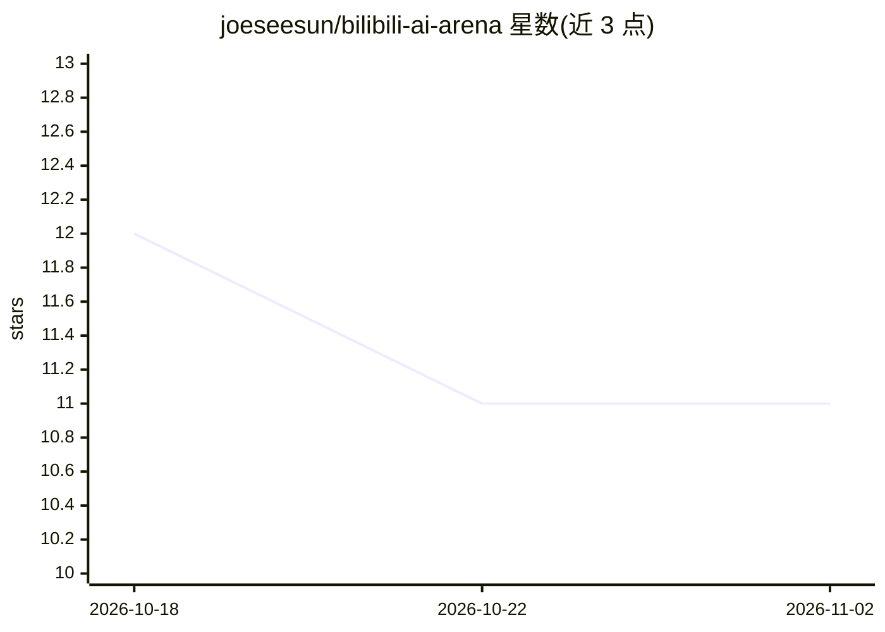

# joeseesun/bilibili-ai-arena

⭐ 11 · JavaScript · MIT · 推送 2026-09-18 · [GitHub](https://github.com/joeseesun/bilibili-ai-arena) · 个人维护 · 中文 README

**B站 AI 无限竞技场测评视频的可检索索引（190个视频/33位UP主）**

面向关注 AI 模型实测内容的观众，收录 B 站 AI 无限竞技场首期测评视频的索引仓库：从竞技场公开接口与首期腾讯文档合并去重，收录 190 个视频、40 个主题、33 位 UP 主，189 条读回完整元数据，1 条元数据不可用但保留 BV 地址并标记。仓库只做索引与导流，点击封面/标题回到 B 站原视频，不存储视频内容。MIT License。

## 筛选速览

| 维度 | 判定 | 备注 |
|---|---|---|
| AI 角色 | `ai-knowledge` | 知识聚合/清单类 |
| 许可风险 | `permissive` | MIT |
| 部署形态 | `None` |  |
| 模型依赖 | — | README 未给出锁定关系 |
| 硬件要求 | — | 无带数字的原话,不猜 |
| 安装摩擦 | `low` | 无编译、无系统依赖或容器化 |
| 成熟度 | — | 结构信号不足 |

## 能力要点

- 收录 190 个视频、40 个主题、33 位 UP 主，来源为公开接口与腾讯文档合并去重
- 189 条视频通过 B 站接口读回完整元数据，1 条标记元数据不可用
- 仅做索引与导流，所有点击回到 B 站原视频与 UP 主主页

## 适用场景

- 查找各 AI 模型（DeepSeek、Claude、GPT、Kimi 等）的实测视频
- 按主题浏览 AI 博弈、编程、狼人杀等测评内容
- 追溯竞技场首期测评的完整视频清单与源数据

## 场景标签

`精选清单` · 领域:学习与行业

## 证据(README 行号)

> L5: > 中国创作者给全球 AI 模型设计的一场非标准化考试。这里收录首期测评视频，只做索引与导流，点击即回到 B 站观看。
> L11: **2026-09-18 实测：** 从竞技场主页公开接口读取到 40 个主题、164 个不重复视频地址；再与首期腾讯文档的 75 个地址合并去重，共收录 **190 个视频、33 位 UP 主**。截图中的 6 个主题及其视频均

## 星数曲线

2026-10-18 12 → 2026-11-02 11（-1）

---
*卡片 v1 · prompt 1.4 · 生成 2026-11-02 · 置信度 high · 依据 README sha `e7c6ad2abf01` · [字段定义](../../DATASET.md)*
