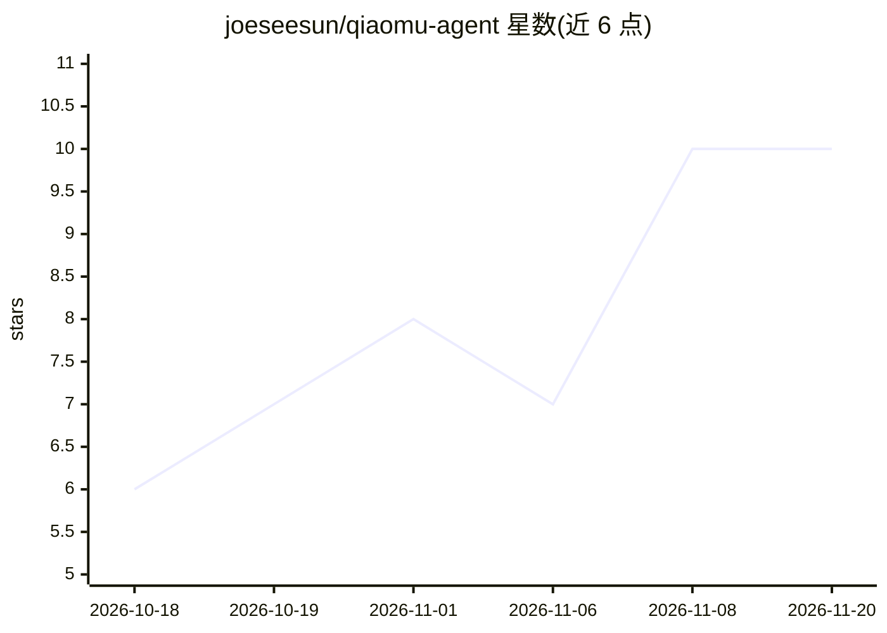

# joeseesun/qiaomu-agent

⭐ 10 · TypeScript · MIT · 推送 2026-11-09 · [GitHub](https://github.com/joeseesun/qiaomu-agent) · 个人维护 · 中文 README

**Obsidian 插件：用本机 Agent 或模型 API 问答、改写笔记并审阅改动**

以 Obsidian 侧边栏形式运行的插件，把当前笔记与编辑器选区作为上下文进行提问，支持用 @ 引用库内文件、文件夹及附加网页、图片；可让 Agent 改写选区或修改文件，按轮查看变更 diff 并撤销，默认文件权限为只读。模型来源分两类：接入本机已安装的 Codex、Claude Code 等 CLI Agent，或登录 ChatGPT、OpenRouter、连接 Magpie 网关、填入自己的 API Key（含 OpenAI、Anthropic、Google、DeepSeek、Kimi、Ollama 及兼容地址）。插件无自有服务器、不收集遥测，API Key 存于 Obsidian SecretStorage。桌面端已在 macOS 验证，本机 CLI 与 MCP 连接仅限桌面端。

## 筛选速览

| 维度 | 判定 | 备注 |
|---|---|---|
| AI 角色 | `ai-native` | 本体是模型或模型工具 |
| 许可风险 | `permissive` | MIT |
| 部署形态 | `library` | 以包/库形式分发 |
| 模型依赖 | local-ok | 支持本地模型 |
| 硬件要求 | — | 无带数字的原话,不猜 |
| 安装摩擦 | `low` | 无编译、无系统依赖或容器化 |
| 成熟度 | — | 结构信号不足 |

## 能力要点

- 选区改写并按轮呈现文件变更 diff，支持撤销，默认只读权限
- 接入本机 Agent（Codex、Claude Code 等 CLI）与多家模型 API，含 Ollama 及兼容地址
- 支持 MCP 工具连接与 Agent Skills 读取，搜索可接 Brave Search
- 回复可追加到今日日记或指定笔记，Markdown、表格与 Mermaid 用 Obsidian 渲染

## 适用场景

- 读笔记时直接提问，让 AI 基于当前笔记和选区回答
- 让 Agent 把选中的草稿改得更正式，再检查 diff 决定是否保留
- 用 @ 引用散落的库内资料做汇总，回复追加进日记
- 通过本机 CLI Agent 或自己的 API Key 调用模型，不依赖插件方服务器

## 场景标签

`知识库管理` `AI 助手` · 领域:对话与助手

## 证据(README 行号)

> L7: 读笔记时直接提问，选中一段话请 Agent 改写，再检查改动并决定是否保留。你可以接入本机已有的 Codex、Claude Code 等 Agent，也可以登录 ChatGPT、词元跳动、OpenRouter，连接 Magpie 网
> L22: |用自己熟悉的模型|在同一入口切换本机 Agent 与模型 API；支持 OpenAI、Anthropic、Google、DeepSeek、Kimi、Ollama 等来源及兼容地址。|

## 星数曲线

2026-10-18 6 → 2026-11-20 10（+4）

---
*卡片 v1 · prompt 1.4 · 生成 2026-11-19 · 置信度 high · 依据 README sha `8c00002f3906` · [字段定义](../../DATASET.md)*
