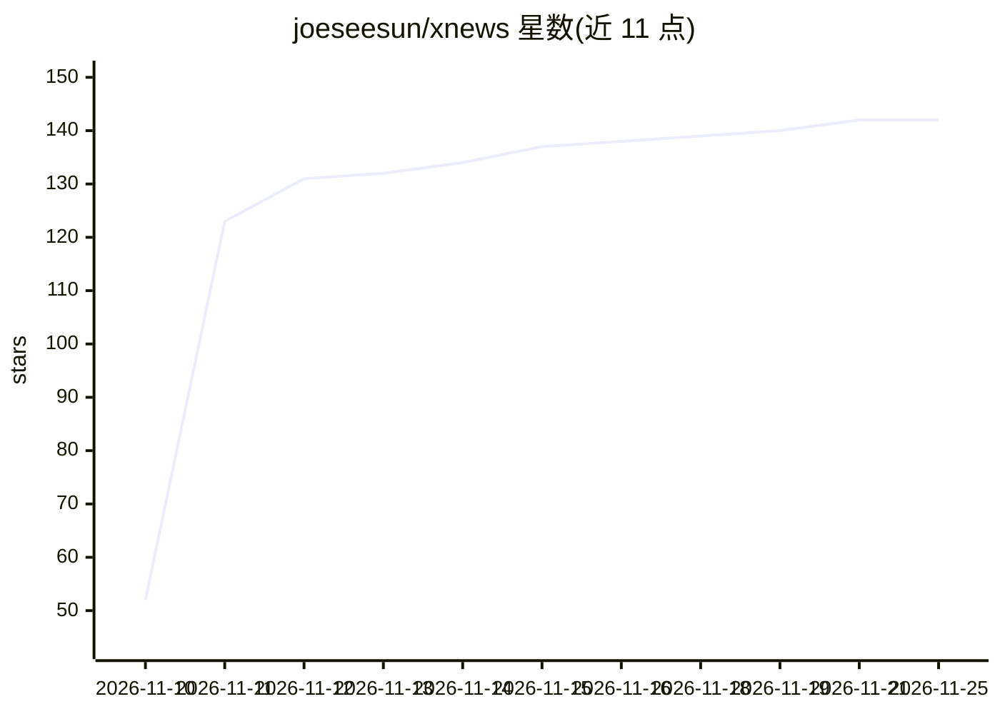

# joeseesun/xnews

⭐ 142 · HTML · 推送 2026-11-24 · [GitHub](https://github.com/joeseesun/xnews) · [官网](https://xnews.qiaomu.ai) · 个人维护 · 中文 README

**将海外创始人帖文与 AI 视频改写为中文的内容站点**

面向中文读者的内容发布项目：选取英文创始人长帖、X Articles 与热门 AI 视频，按编辑规范将文字与媒体（图片/视频/音频）改写为完整自然的中文并保留原文链接，输出为静态站点与 RSS。内容以 JSON 文章文件存于 content/articles/，由 Nginx 静态托管，Cloudflare Worker 作为后备。仓库不含抓取代码，内容生产依赖既有 X 工具与 WebFetch 按日常流程人工执行。前端提供搜索、视频过滤、纯文本扫描视图等阅读功能。

## 筛选速览

| 维度 | 判定 | 备注 |
|---|---|---|
| AI 角色 | `ai-native` | 本体是模型或模型工具 |
| 许可风险 | `none` | — |
| 部署形态 | `library` | 以包/库形式分发 |
| 模型依赖 | — | README 未给出锁定关系 |
| 硬件要求 | — | 无带数字的原话,不猜 |
| 安装摩擦 | `low` | 无编译、无系统依赖或容器化 |
| 成熟度 | — | 结构信号不足 |

## 能力要点

- 英文帖文与媒体内容改写为中文并附原文链接
- 文章数据以 JSON 存于 content/articles/，静态站点 + RSS 输出
- Nginx 主托管，Cloudflare Worker 作为 fallback 部署
- 首页支持按标题/作者/主题搜索与视频过滤

## 适用场景

- 作为中文读者获取海外创始人观点与 AI 视频内容
- 通过 RSS 订阅每日改写更新的内容
- 浏览可按主题、作者、是否有视频过滤的阅读视图

## 场景标签

 · 领域:媒体/内容发布

## 证据(README 行号)

> L3: 海外创始人长帖 / X Articles / 爆款 AI 视频 → **完整、自然的中文改写（含原媒体）**，附原文链接。
> L5: - Live: https://xnews.qiaomu.ai

## 星数曲线

2026-11-10 52 → 2026-11-25 142（+90）

---
*卡片 v1 · prompt 1.4 · 生成 2026-11-18 · 置信度 mid · 依据 README sha `ddfa87143a14` · [字段定义](../../DATASET.md)*
