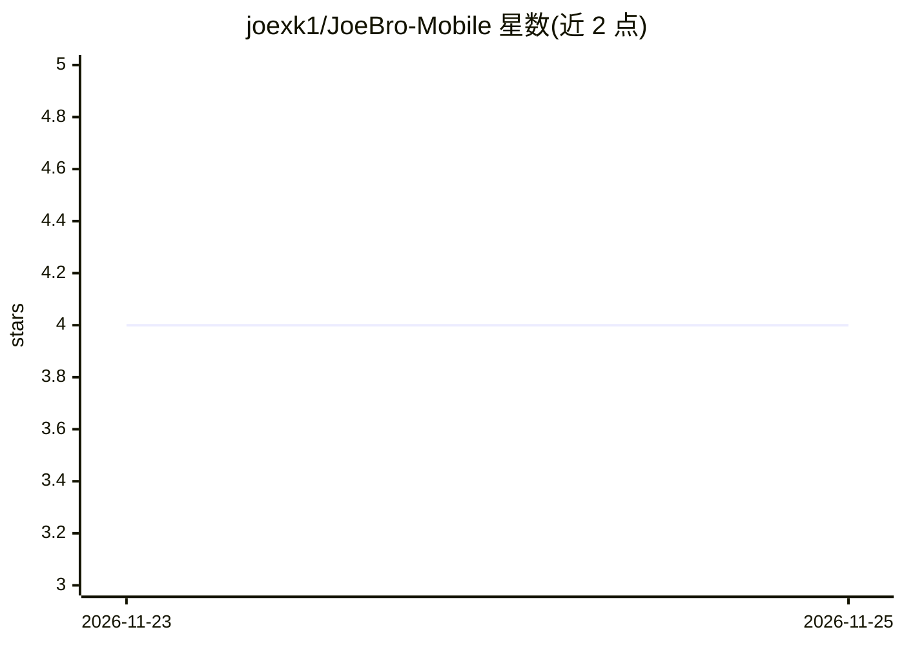

# joexk1/JoeBro-Mobile

⭐ 4 · Swift · GPL-3.0 · 推送 2026-11-22 · [GitHub](https://github.com/joexk1/JoeBro-Mobile) · [官网](https://joebro.pages.dev) · 个人维护

**iPhone 端伴侣应用：在手机上查看并操控你 Mac 上运行的 AI agent**

JoeBro 的 iPhone 伴侣端，需与 Mac 上的 JoeBro（1.3+）配对使用，无中间服务器，数据不经第三方。功能：在聊天列表中查看并回复 Claude Code、Codex、OpenCode 会话，锁屏/灵动岛审批 agent 提问；1.5 新增 Night Shift 夜间排队编码任务（各自 git 分支、晨间 diff 审查卡）、基于 MCP 的多 agent 共享记忆、后台 phone agent（心跳检查、任务通知、简报）。源码发布，无 App Store 版本，需自备签名团队用 Xcode 自行构建。

## 筛选速览

| 维度 | 判定 | 备注 |
|---|---|---|
| AI 角色 | `ai-native` | 本体是模型或模型工具 |
| 许可风险 | `viral` | GPL-3.0 |
| 部署形态 | `None` |  |
| 模型依赖 | — | README 未给出锁定关系 |
| 硬件要求 | — | 无带数字的原话,不猜 |
| 安装摩擦 | `low` | 无编译、无系统依赖或容器化 |
| 成熟度 | — | 结构信号不足 |

## 能力要点

- 查看/回复任意电脑上的 Claude Code、Codex、OpenCode 会话，锁屏与灵动岛审批
- Night Shift 夜间排队编码任务，晨间 diff/test 审查卡，拒绝需 Face ID
- 基于 MCP 的跨 agent 共享记忆，个人事实与仓库隔离
- 全部 agent 计算在用户自己的 Mac 上运行，token 仅存本机 Keychain

## 适用场景

- 外出时用手机跟进并回复家里 Mac 上运行的编码 agent
- 睡前从手机排队编码任务，早上在锁屏审批或拒绝
- 在手机上读取/编辑 agent 记忆文件与收件箱通知

## 场景标签

`编码 Agent` `AI 助手` · 领域:编码与开发

## 证据(README 行号)

> L14: The app shows what JoeBro on your Mac is doing: your chats, your models, and the Claude Code, Codex and OpenCode se
> L119: The phone agent is JoeBro, on your phone, with a memory and a to-do list. All of it runs on your Mac. The phone is
> L24: Claude Code, Codex and OpenCode sessions appear in your chat list while they are open in a terminal on any of your 

## 星数曲线

2026-11-23 4 → 2026-11-25 4（+0）

---
*卡片 v1 · prompt 1.4 · 生成 2026-11-23 · 置信度 mid · 依据 README sha `5abca475750a` · [字段定义](../../DATASET.md)*
