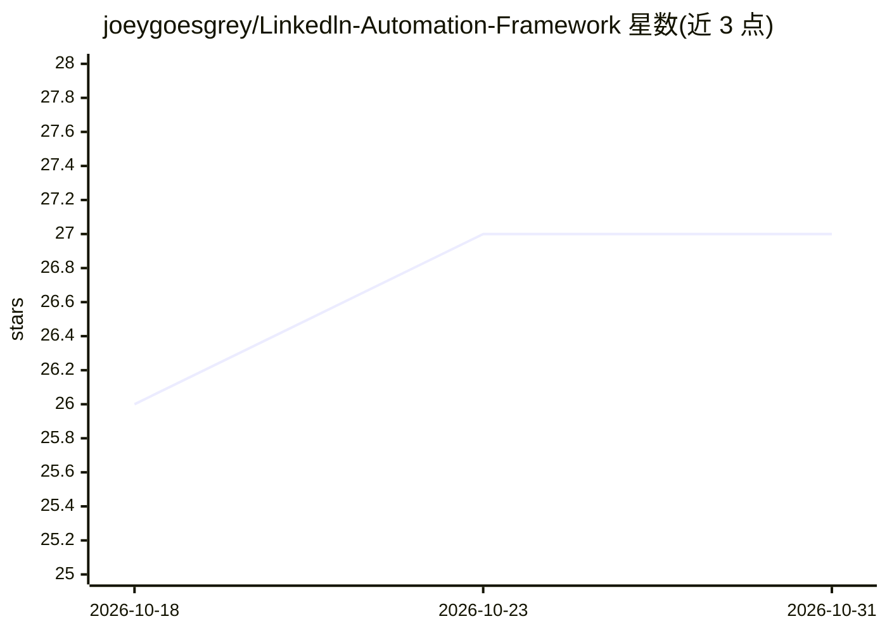

# joeygoesgrey/Linkedln-Automation-Framework

⭐ 27 · Python · MIT · 推送 2026-05-13 · [GitHub](https://github.com/joeygoesgrey/Linkedln-Automation-Framework) · [官网](https://laf-ui.vercel.app/) · 个人维护

**Selenium 驱动的 LinkedIn 自动化框架：发帖、互动与 AI 评论**

生产级 Python 框架，通过 Selenium 操控真实 Chromium 浏览器在 LinkedIn 上执行拟人化操作。提供五个命令：post（发帖/定时/附图）、engage（滚动信息流点赞评论）、pursue（按简介关键词定向互动）、repost（转发并 @原作者）、generate-calendar（生成 30 天内容策略）。评论文案由 OpenAI API 生成，需用户自行提供 OPENAI_API_KEY 与 LinkedIn 凭据，可用 --no-ai 切换本地模板。内置 URN 去重、人类节奏延迟与逐字输入以降低封号风险。

## 筛选速览

| 维度 | 判定 | 备注 |
|---|---|---|
| AI 角色 | `ai-enhanced` | 去掉 AI 部分产品仍成立 |
| 许可风险 | `permissive` | MIT |
| 部署形态 | `None` |  |
| 模型依赖 | — | README 未给出锁定关系 |
| 硬件要求 | — | 无带数字的原话,不猜 |
| 安装摩擦 | `low` | 无编译、无系统依赖或容器化 |
| 成熟度 | — | 结构信号不足 |

## 能力要点

- 5 个 CLI 命令：post/engage/pursue/repost/generate-calendar
- OpenAI 生成上下文评论，--no-ai 可切换本地模板
- URN 去重缓存确保不重复点赞/评论同帖
- 人类节奏延迟、逐字输入、自动跳过已互动内容

## 适用场景

- 定时或批量发布 LinkedIn 帖子并附带随机图片
- 自动滚动信息流点赞并用 AI 撰写评论保持账号活跃
- 按简介关键词定向关注投资人等目标人物

## 场景标签

`浏览器自动化` `AI 写作` · 领域:效率与自动化

## 证据(README 行号)

> L7: LAF is a production-grade Python framework that automates a real Chromium browser to perform human-like actions on L
> L39: - **Sub-Feature: AI Chatter:** Writes context-aware, smart comments using OpenAI.

## 星数曲线

2026-10-18 26 → 2026-10-31 27（+1）

---
*卡片 v1 · prompt 1.4 · 生成 2026-10-26 · 置信度 high · 依据 README sha `36dee9726bf5` · [字段定义](../../DATASET.md)*
