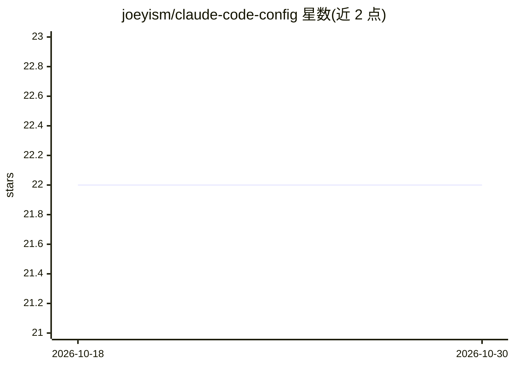

# joeyism/claude-code-config

⭐ 22 · Python · MIT · 推送 2026-01-04 · [GitHub](https://github.com/joeyism/claude-code-config) · 个人维护

**管理 Claude Code 配置文件的 TUI 工具**

一个终端用户界面应用，用于读写和管理 Claude Code 的配置文件 ~/.claude.json：以树状结构浏览与增删改全局/项目级 MCP 服务器（支持 stdio/HTTP/SSE 类型），在全局与项目作用域间移动或复制服务器配置，并扫描 ~/.claude/projects/ 下的 .jsonl 文件以浏览、统计和删除历史会话。操作前自动备份，支持撤销/重做（最多 50 步）、JSON 校验、敏感值默认掩码。通过 pip 安装，运行 claude-config 或 ccm 命令启动。

## 筛选速览

| 维度 | 判定 | 备注 |
|---|---|---|
| AI 角色 | `ai-ecosystem` | LLM/agent 周边工具 |
| 许可风险 | `permissive` | MIT |
| 部署形态 | `library` | 以包/库形式分发 |
| 模型依赖 | — | README 未给出锁定关系 |
| 硬件要求 | — | 无带数字的原话,不猜 |
| 安装摩擦 | `low` | 无编译、无系统依赖或容器化 |
| 成熟度 | — | 结构信号不足 |

## 能力要点

- 全局/项目级 MCP 服务器的树状浏览与完整增删改
- 扫描 .jsonl 会话文件，提供消息数、文件大小、时间统计与删除
- 保存前自动备份，撤销/重做最多 50 步，JSON 校验
- 环境变量与 headers 中敏感值默认掩码（按 V 切换）

## 适用场景

- 在大量项目和服务器配置中查找并安全编辑 MCP 服务器
- 清理占用磁盘的旧会话 .jsonl 文件并查看统计
- 在项目之间复制或移动 MCP 服务器配置
- 浏览配置时不暴露 API key 等敏感值

## 场景标签

 · 领域:开发者工具/AI 配置管理

## 证据(README 行号)

> L3: A modern Terminal User Interface (TUI) application for managing Claude Code configuration files (`~/.claude.json`). 
> L101: - **mcpServers**: Global MCP (Model Context Protocol) server configurations

## 星数曲线

2026-10-18 22 → 2026-10-30 22（+0）

---
*卡片 v1 · prompt 1.4 · 生成 2026-10-27 · 置信度 high · 依据 README sha `6bdd0565eb60` · [字段定义](../../DATASET.md)*
