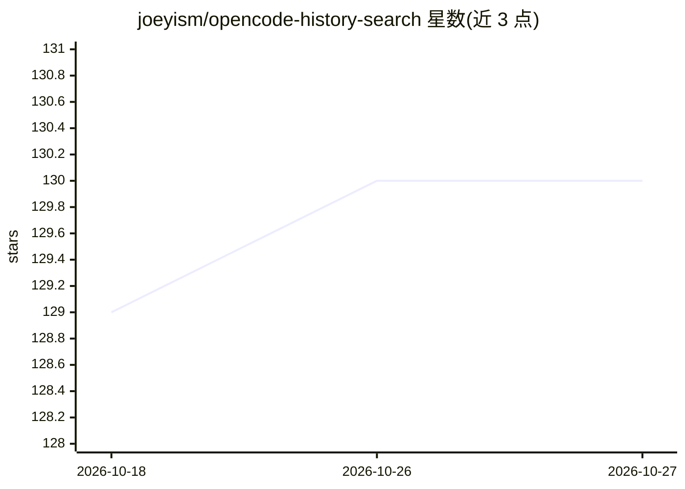

# joeyism/opencode-history-search

⭐ 130 · TypeScript · MIT · 推送 2026-07-19 · [GitHub](https://github.com/joeyism/opencode-history-search) · [官网](https://www.npmjs.com/package/opencode-history-search) · 个人维护

**OpenCode 插件：按关键词/正则/模糊检索历史会话**

面向 OpenCode 用户的对话历史检索插件：读取 OpenCode v1.2+ 的 SQLite（opencode.db）或 v1.1.x 的 JSON 存储文件，支持关键词、正则、模糊（Levenshtein）与多词 AND 检索；可按日期、消息角色过滤，追踪特定文件的修改来源，并支持跨全部项目全局检索。默认按 git 根限定当前仓库范围。安装方式包括 OpenCode 配置声明、npx 快速安装或源码构建（Bun）。

## 筛选速览

| 维度 | 判定 | 备注 |
|---|---|---|
| AI 角色 | `ai-ecosystem` | LLM/agent 周边工具 |
| 许可风险 | `permissive` | MIT |
| 部署形态 | `library` | 以包/库形式分发 |
| 模型依赖 | — | README 未给出锁定关系 |
| 硬件要求 | — | 无带数字的原话,不猜 |
| 安装摩擦 | `low` | 无编译、无系统依赖或容器化 |
| 成熟度 | — | 结构信号不足 |

## 能力要点

- 关键词/正则/模糊（Levenshtein）与会话级多词 AND 检索
- 日期过滤与 user/assistant 角色过滤
- 追踪特定文件被哪些会话修改
- 兼容 SQLite（v1.2+）与 JSON（v1.1.x）两种存储，支持全局跨项目搜索

## 适用场景

- 查找曾在某项目讨论过某主题的会话
- 定位 AI 曾修改过某文件的历史会话
- 通过自然语言让 OpenCode 检索自己的历史对话

## 场景标签

 · 领域:开发者工具/AI 辅助编程

## 证据(README 行号)

> L8: Search through your OpenCode conversation history across ALL projects or within the current repository. Supports key
> L37:     "opencode-history-search"

## 星数曲线

2026-10-18 129 → 2026-10-27 130（+1）

---
*卡片 v1 · prompt 1.4 · 生成 2026-10-23 · 置信度 high · 依据 README sha `9255f7228c7b` · [字段定义](../../DATASET.md)*
