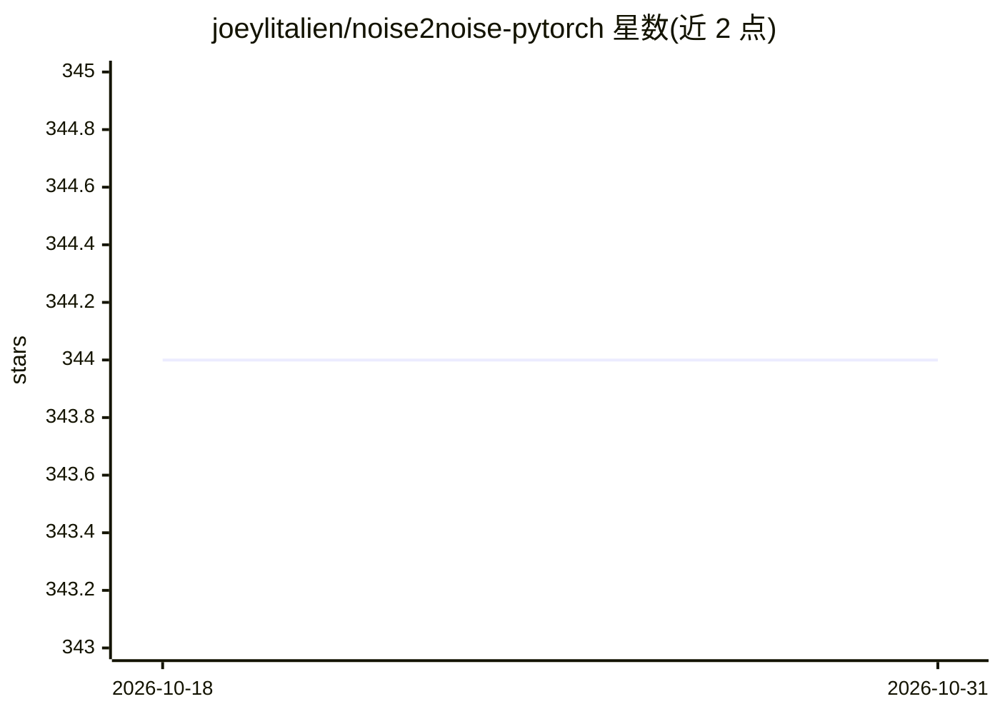

# joeylitalien/noise2noise-pytorch

⭐ 344 · Python · MIT · 推送 2026-10-26 · [GitHub](https://github.com/joeylitalien/noise2noise-pytorch) · 个人维护

**Noise2Noise 图像去噪的 PyTorch 非官方实现**

Lehtinen 等 2018 年 Noise2Noise 论文的非官方 PyTorch 复现：用带噪目标图像训练去噪模型，无需干净数据，支持高斯噪声、泊松噪声、文字遮挡与蒙特卡洛渲染噪声四种噪声类型。提供 train.py/test.py 训练测试脚本，可用 COCO 2017 数据集训练，默认不启用 CUDA，可用 --cuda 选项开启。README 列出已知实现问题：U-Net 编解码器共享权重、激活函数与论文相反。仅在 macOS 与 Ubuntu 的 Python 3.6 环境测试，Windows 开箱即失败。

## 筛选速览

| 维度 | 判定 | 备注 |
|---|---|---|
| AI 角色 | `ai-native` | 本体是模型或模型工具 |
| 许可风险 | `permissive` | MIT |
| 部署形态 | `library` | 以包/库形式分发 |
| 模型依赖 | — | README 未给出锁定关系 |
| 硬件要求 | — | 无带数字的原话,不猜 |
| 安装摩擦 | `medium` | 含编译或系统依赖之一 |
| 成熟度 | — | 结构信号不足 |

## 能力要点

- 支持高斯/泊松/文字遮挡/蒙特卡洛渲染四种噪声类型训练
- 可用带噪目标训练，无需干净图像（也可 --clean-targets 切换）
- 提供 train.py/test.py 脚本与示例 shell 脚本
- README 明确列出多项与论文不一致的已知实现问题

## 适用场景

- 复现或学习 Noise2Noise 去噪方法
- 在自有图像数据上训练去噪模型
- 对比带噪目标与干净目标训练的去噪效果

## 场景标签

`图像视频处理` · 领域:感知与多模态

## 证据(README 行号)

> L3: This is an unofficial PyTorch implementation of Noise2Noise (Lehtinen et al. 2018).
> L50: By default, the model train with noisy targets. To train with clean targets, use `--clean-targets`. To train and va

## 星数曲线

2026-10-18 344 → 2026-10-31 344（+0）

---
*卡片 v1 · prompt 1.4 · 生成 2026-10-21 · 置信度 high · 依据 README sha `4be0f986c40b` · [字段定义](../../DATASET.md)*
