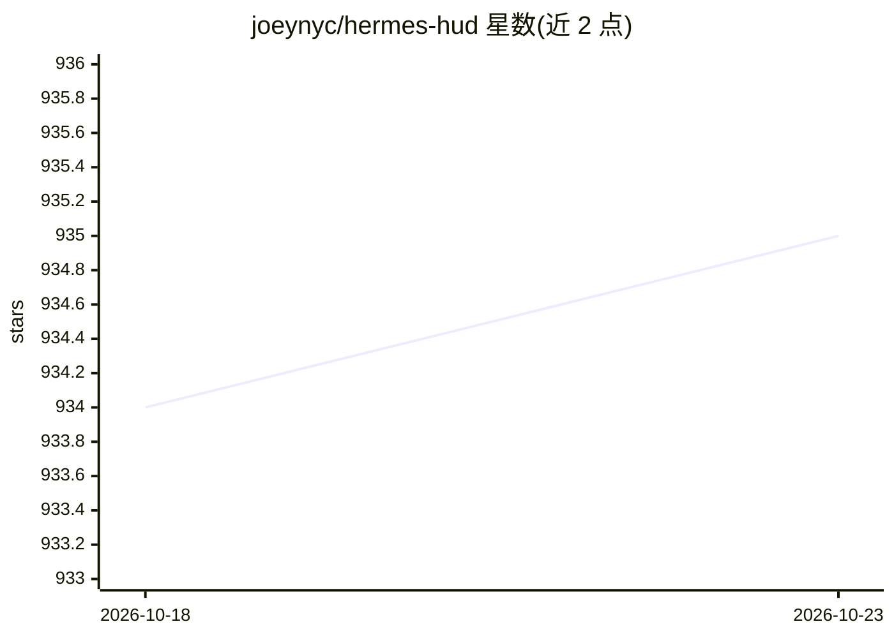

# joeynyc/hermes-hud

⭐ 935 · Python · MIT · 推送 2026-10-22 · [GitHub](https://github.com/joeynyc/hermes-hud) · 个人维护

**监控 Hermes AI agent 自身状态的终端仪表盘**

基于 Textual 的终端 TUI 应用，读取 ~/.hermes/ 目录下 Hermes AI 助手的持久化数据，实时展示 agent 的对话记录、已习得技能、错误修正日志、记忆容量、工具使用模式、活跃 Git 项目与 API key/服务健康状态等。提供 9 个标签页、4 套配色主题、快照 diff 增长追踪、cron 任务监控与 tmux 操作员视图，另支持 --text 文本输出与 --snapshot 快照。需 Python 3.11+，通过源码 venv 安装，运行于 macOS 与 Linux。

## 筛选速览

| 维度 | 判定 | 备注 |
|---|---|---|
| AI 角色 | `ai-ecosystem` | LLM/agent 周边工具 |
| 许可风险 | `permissive` | MIT |
| 部署形态 | `library` | 以包/库形式分发 |
| 模型依赖 | — | README 未给出锁定关系 |
| 硬件要求 | — | 无带数字的原话,不猜 |
| 安装摩擦 | `low` | 无编译、无系统依赖或容器化 |
| 成熟度 | — | 结构信号不足 |

## 能力要点

- 读取 ~/.hermes/ 数据实时展示 agent 记忆、技能与错误修正记录
- 9 个标签页、4 套主题、键盘导航的交互式 TUI
- 快照 diff 追踪 agent 逐日变化
- tmux 操作员视图：活动 agent 映射到窗格与审批队列

## 适用场景

- 长期观察自己 AI agent 的记忆与技能增长
- 排查 agent 的错误修正历史与服务健康状态
- 运维多个 Hermes agent 实例时统一查看状态

## 场景标签

`LLM 可观测性` · 领域:评测与运维

## 证据(README 行号)

> L5: **Hermes HUD** is a consciousness monitor for AI agents. A terminal dashboard that watches an agent think — its memo
> L11: Hermes HUD reads from `~/.hermes/` and surfaces everything the agent knows about itself — conversations held, skill

## 星数曲线

2026-10-18 934 → 2026-10-23 935（+1）

---
*卡片 v1 · prompt 1.4 · 生成 2026-10-21 · 置信度 mid · 依据 README sha `51d30b4b8afc` · [字段定义](../../DATASET.md)*
