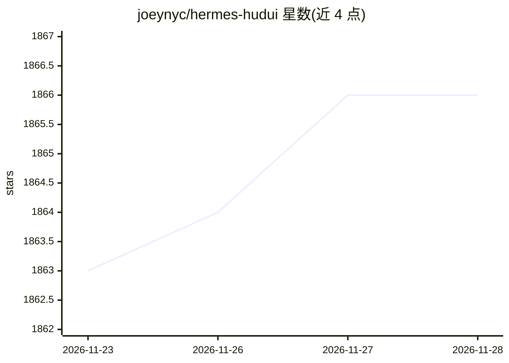

# joeynyc/hermes-hudui

⭐ 1,866 · Python · MIT · 推送 2026-11-19 · [GitHub](https://github.com/joeynyc/hermes-hudui) · 个人维护 · 中文 README

**为 Hermes 记忆型 AI Agent 提供浏览器端监控仪表盘**

Hermes Agent 的 Web UI 监控面板：读取 ~/.hermes/ 数据目录与 hermes CLI，以 19 个标签页展示健康诊断、记忆、技能、会话、成本、模型分析、网关路由与插件管理等；通过 WebSocket 实时更新，支持会话回放导出脱敏产物（JSON/Markdown/HTML/PNG）与可选远程发布。默认仅本机回环监听，拒绝跨站与非回环访问。需 Python 3.11+、Node.js 22.12+ 及运行中的 Hermes agent；支持中英文切换与五套主题。

## 筛选速览

| 维度 | 判定 | 备注 |
|---|---|---|
| AI 角色 | `ai-ecosystem` | LLM/agent 周边工具 |
| 许可风险 | `permissive` | MIT |
| 部署形态 | `library` | 以包/库形式分发 |
| 模型依赖 | — | README 未给出锁定关系 |
| 硬件要求 | — | 无带数字的原话,不猜 |
| 安装摩擦 | `low` | 无编译、无系统依赖或容器化 |
| 成熟度 | — | 结构信号不足 |

## 能力要点

- 19 个标签页覆盖记忆、会话、成本、网关与插件等状态视图
- WebSocket 实时更新，无需手动刷新
- Replay 导出脱敏回放产物，含 Ed25519 本地签名
- 默认 local-only，支持显式配置 LAN 绑定与来源白名单

## 适用场景

- 查看运行中 Hermes agent 的记忆、会话与健康状态
- 分析 agent 的模型用量与成本
- 将 agent 运行记录导出为可分享的脱敏回放

## 场景标签

`LLM 可观测性` · 领域:评测与运维

## 证据(README 行号)

> L3: A browser-based consciousness monitor for Hermes, the AI agent with persistent memory.
> L30: **Verified against Hermes Agent v0.20.3** (state.db schema v26), with compatibility retained for schemas v16 and v2
> L39: 19 tabs covering everything your agent knows about itself — executive dashboard, identity, memory, skills, sessions

## 星数曲线

2026-11-23 1,863 → 2026-11-28 1,866（+3）

---
*卡片 v1 · prompt 1.4 · 生成 2026-11-23 · 置信度 high · 依据 README sha `154a3d89c2a0` · [字段定义](../../DATASET.md)*
