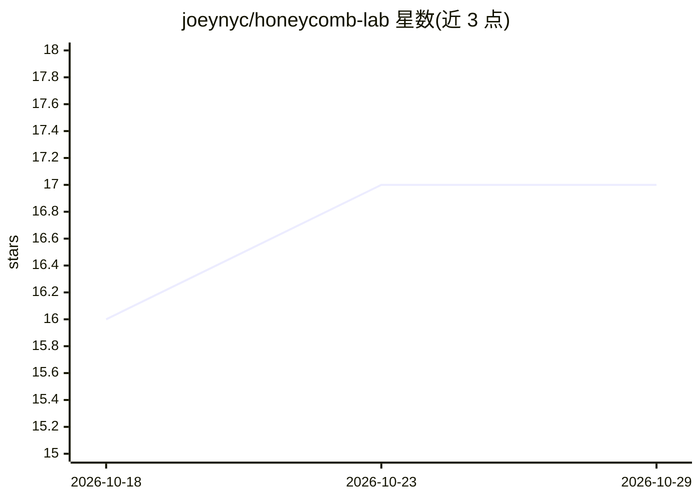

# joeynyc/honeycomb-lab

⭐ 17 · Swift · MIT · 推送 2026-10-26 · [GitHub](https://github.com/joeynyc/honeycomb-lab) · 个人维护

**家庭 GPU 集群的 OpenAI 兼容网关与六边形地图控制面板**

面向自建家庭 AI 集群的控制平面：macOS 原生应用（菜单栏）加网关自带的 Web 面板，将 vLLM、LM Studio 及任意 OpenAI 兼容端点聚合到 http://<hub>:4000/v1 单一入口，支持 cheap/any 成本路由与请求中自动故障转移。以六边形地图展示节点健康、GPU 利用率、KV-cache、tok/s 与延迟，可通过 SSH 对节点 PING/SERVE/STOP 并集成 spark-doctor 自动诊断。网关用 Python stdlib 零依赖实现，需 macOS 14+；控制接口用 token 鉴权，无 TLS，限定可信局域网或 tailnet 使用。

## 筛选速览

| 维度 | 判定 | 备注 |
|---|---|---|
| AI 角色 | `ai-ecosystem` | LLM/agent 周边工具 |
| 许可风险 | `permissive` | MIT |
| 部署形态 | `None` |  |
| 模型依赖 | local-ok | 支持本地模型 |
| 硬件要求 | — | 无带数字的原话,不猜 |
| 安装摩擦 | `low` | 无编译、无系统依赖或容器化 |
| 成熟度 | — | 结构信号不足 |

## 能力要点

- OpenAI 兼容网关聚合 vLLM/LM Studio 等后端，支持 cheap/any 路由与故障转移
- 六边形地图实时展示节点健康、GPU、KV-cache、tok/s 与延迟
- SSH 远程 SERVE/STOP 推理容器，集成 spark-doctor 自动诊断
- 网关基于 Python stdlib，零依赖，自带 Web 面板可在 iPad/手机使用

## 适用场景

- 把家里多台 GPU 机器的模型统一到一个 OpenAI 兼容端点
- 在地图上监控整个推理集群的健康与流量
- 手机或 iPad 上远程启停节点推理容器并查看诊断结果

## 场景标签

`模型网关` `MLOps` · 领域:Agent 开发

## 证据(README 行号)

> L7: A control plane and OpenAI-compatible gateway for your home AI fleet:
> L24: Point any OpenAI-compatible client at `http://<hub>:4000/v1`. Route by

## 星数曲线

2026-10-18 16 → 2026-10-29 17（+1）

---
*卡片 v1 · prompt 1.4 · 生成 2026-10-29 · 置信度 high · 依据 README sha `f94e61019f8b` · [字段定义](../../DATASET.md)*
