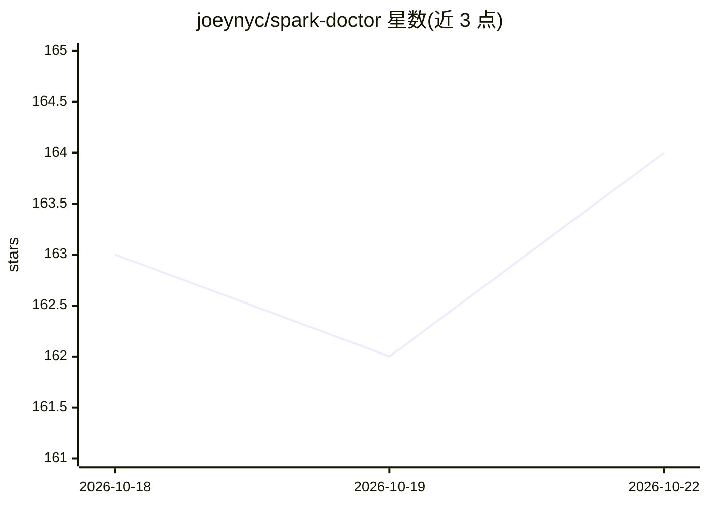

# joeynyc/spark-doctor

⭐ 164 · Python · MIT · 推送 2026-10-22 · [GitHub](https://github.com/joeynyc/spark-doctor) · 个人维护

**NVIDIA DGX Spark 本地诊断 CLI：定位硬件/运行时问题**

面向 NVIDIA DGX Spark（GB10）机主的本地诊断命令行工具：一条命令收集系统、GPU、内存、Docker、运行时与 recipe 数据，按 DGX Spark 专属规则输出问题、原因与下一步建议，覆盖 14W 低功耗锁定、UMA 内存压力、过热、Docker 运行时未注册、CUDA 13/SM_121 wheel 不匹配等约 18 类检测，并校验 vLLM/Ollama/llama.cpp/SGLang recipe。只读、无自动修复、无遥测，报告默认匿名化。需 Python 3.11+，源码安装。

## 筛选速览

| 维度 | 判定 | 备注 |
|---|---|---|
| AI 角色 | `ai-ecosystem` | LLM/agent 周边工具 |
| 许可风险 | `permissive` | MIT |
| 部署形态 | `self-host` | docker 或自建部署 |
| 模型依赖 | — | README 未给出锁定关系 |
| 硬件要求 | — | 无带数字的原话,不猜 |
| 安装摩擦 | `low` | 无编译、无系统依赖或容器化 |
| 成熟度 | — | 结构信号不足 |

## 能力要点

- 约 18 条 DGX Spark 专属规则（功耗/热/UMA/CUDA wheel/Docker/Xid 等）
- 校验 vLLM/Ollama/llama.cpp/SGLang recipe（张量并行、内存预算、arm64 兼容）
- 报告默认匿名化：主机名/IP/MAC/序列号/密钥模式均脱敏
- 只读设计：不安装包、不改驱动、不杀进程，修复以文字说明给出

## 适用场景

- DGX Spark 上推理变慢时定位 14W 功耗锁定或 UMA 压力
- 排查 PyTorch CUDA 13 / SM_121 wheel 与 GB10 不匹配问题
- 部署 vLLM 等 recipe 前校验配置合理性与 KV cache OOM 风险

## 场景标签

 · 领域:硬件诊断/LLM 运维

## 证据(README 行号)

> L3: Local diagnostic CLI for NVIDIA DGX Spark. Collects system, GPU, memory, Docker, runtime, network, and recipe data, 
> L11: DGX Spark is a new platform. When something goes wrong, the signal is scattered across `nvidia-smi`, `/proc/pressur
> L61: Recipe validator checks tensor-parallel vs GPU count, container image registry, arm64 compatibility, memory budget,

## 星数曲线

2026-10-18 163 → 2026-10-22 164（+1）

---
*卡片 v1 · prompt 1.4 · 生成 2026-10-22 · 置信度 mid · 依据 README sha `f749eb945c81` · [字段定义](../../DATASET.md)*
