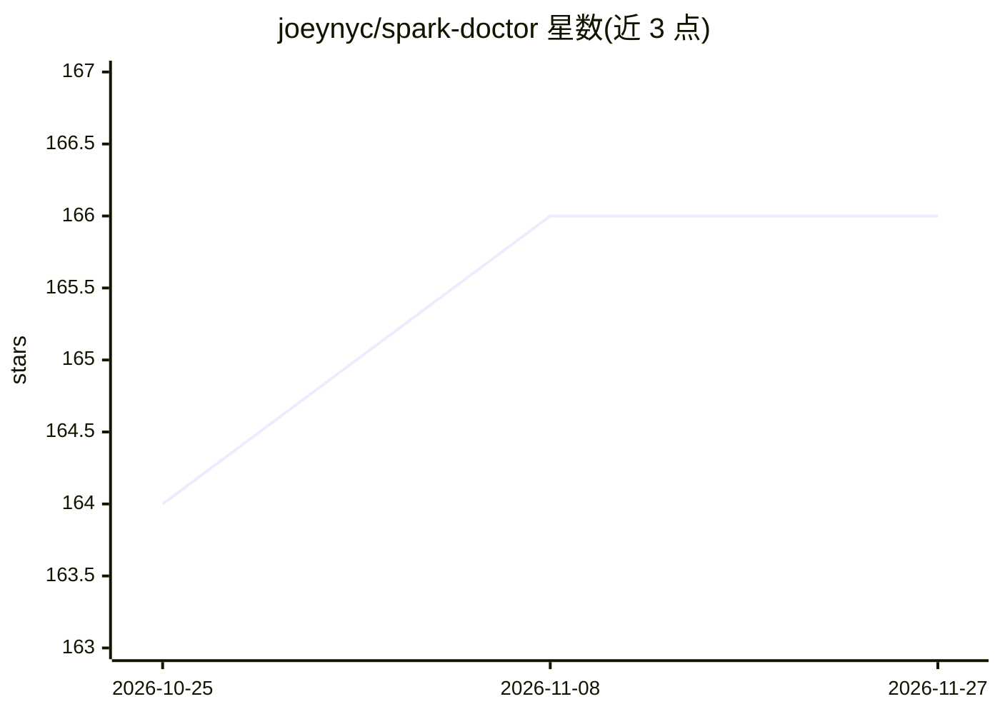

# joeynyc/spark-doctor

⭐ 166 · Python · MIT · 推送 2026-11-18 · [GitHub](https://github.com/joeynyc/spark-doctor) · 个人维护

**NVIDIA DGX Spark 本地诊断 CLI：定位推理环境故障原因**

面向 NVIDIA DGX Spark（GB10）的本地诊断 CLI：一条命令采集系统、GPU、内存、Docker、运行时、网络与推理配方数据，应用针对 DGX Spark 的规则库，输出问题、原因与下一步建议，只读、无遥测、不做自动修复。检测项覆盖低功耗卡死、统一内存压力、过热风险、CUDA 12/SM_121 wheel 不匹配、Docker runtime 配置错误、OOM/Xid 错误，并校验 vLLM/Ollama/llama.cpp/SGLang 配方（张量并行、内存预算、arm64 兼容）。报告默认脱敏，凭据与网络标识可被抹除。需 Python 3.11+，源码安装。

## 筛选速览

| 维度 | 判定 | 备注 |
|---|---|---|
| AI 角色 | `ai-ecosystem` | LLM/agent 周边工具 |
| 许可风险 | `permissive` | MIT |
| 部署形态 | `self-host` | docker 或自建部署 |
| 模型依赖 | — | README 未给出锁定关系 |
| 硬件要求 | — | 无带数字的原话,不猜 |
| 安装摩擦 | `low` | 无编译、无系统依赖或容器化 |
| 成熟度 | — | 结构信号不足 |

## 能力要点

- 17 项 DGX Spark 专属检测规则（功耗/温度/UMA/CUDA/Docker/OOM/Xid）
- 校验 vLLM/Ollama/llama.cpp/SGLang 运行配方（张量并行、内存预算、arm64）
- 报告默认脱敏：IP/MAC/序列号/凭据模式自动抹除
- 只读安全设计：无安装/驱动/进程操作，仅输出修复指令

## 适用场景

- DGX Spark 推理卡顿时定位低功耗、内存压力或 CUDA wheel 问题
- 部署本地 LLM 配方前校验张量并行与内存预算
- 分享诊断报告时保留默认脱敏以避免泄露凭据

## 场景标签

 · 领域:开发运维/硬件诊断工具

## 证据(README 行号)

> L3: Local diagnostic CLI for NVIDIA DGX Spark. Collects system, GPU, memory, Docker, runtime, network, and recipe data, 
> L67: Recipe validator checks tensor-parallel vs GPU count, container image registry (an image must be a known repository
> L73: Recipes can also declare `runtime.command`, `runtime.quantization`, and an optional top-level `is_moe` override. Fo

## 星数曲线

2026-10-25 164 → 2026-11-27 166（+2）

---
*卡片 v1 · prompt 1.4 · 生成 2026-11-27 · 置信度 mid · 依据 README sha `29ed42242f4e` · [字段定义](../../DATASET.md)*
