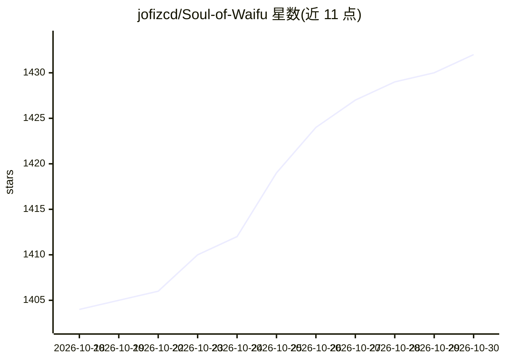

# jofizcd/Soul-of-Waifu

⭐ 1,432 · Python · GPL-3.0 · 推送 2026-08-28 · [GitHub](https://github.com/jofizcd/Soul-of-Waifu) · [官网](https://jofizcd.github.io/soul-of-waifu-site/) · 个人维护

**本地优先的桌面 AI 角色陪伴应用：角色跨聊天、RPG 与桌面代理**

开源桌面应用（v2.4.7），创建一个 AI 角色后在多个互联模式中使用：文字与语音聊天（Live2D/VRM 立牌）、Soul Memory 长期记忆架构（四层认知文件、情绪衰减、记忆自愈）、Soul Stage 桌面跑团引擎（独立 AI 主持人、骰子与技能检定、隐藏剧情线），以及 Soul Companion 桌面自主代理（读屏、控键鼠、Playwright 浏览器、沙箱执行代码、MCP 扩展，风险操作需人工批准）。默认 100% 本地运行，云端 AI（OpenAI/Claude/Gemini 等）为可选插件；支持 Discord 接入与手机局域网 Web 客户端。

## 筛选速览

| 维度 | 判定 | 备注 |
|---|---|---|
| AI 角色 | `ai-native` | 本体是模型或模型工具 |
| 许可风险 | `viral` | GPL-3.0 |
| 部署形态 | `desktop` | 安装包/桌面程序 |
| 模型依赖 | local-ok | 支持本地模型 |
| 硬件要求 | `cpu-ok` | |
| 安装摩擦 | `medium` | 含编译或系统依赖之一 |
| 成熟度 | — | 结构信号不足 |

## 能力要点

- 单一角色身份跨聊天/RPG/桌面代理多模式持续存在
- Soul Memory 四层认知文件架构（心理/关系/情景档案/日记）与记忆自愈
- Soul Stage 桌面 RPG 引擎：确定性骰子、WorldState、隐藏剧情线、Campaign Board
- Soul Companion 计算机操作代理：8 类内置工具 + MCP 扩展，25 秒人工审批兜底

## 适用场景

- 与自定义 AI 角色进行文字/语音长期陪伴互动
- 由 AI 主持人驱动的桌面跑团角色扮演
- 让 AI 角色以桌面代理形式协助操作电脑与整理文件

## 场景标签

`聊天机器人` `GUI 自动化` · 领域:效率与自动化

## 证据(README 行号)

> L29: **Soul of Waifu (SoW)** is a free, open-source desktop app where AI characters can remember, evolve, and exist acro
> L37: Everything runs **100% locally on your PC by default** - your chats with characters can live entirely offline, with

## 星数曲线

2026-10-18 1,404 → 2026-10-30 1,432（+28）

---
*卡片 v1 · prompt 1.4 · 生成 2026-10-21 · 置信度 high · 依据 README sha `579b70576c0d` · [字段定义](../../DATASET.md)*
