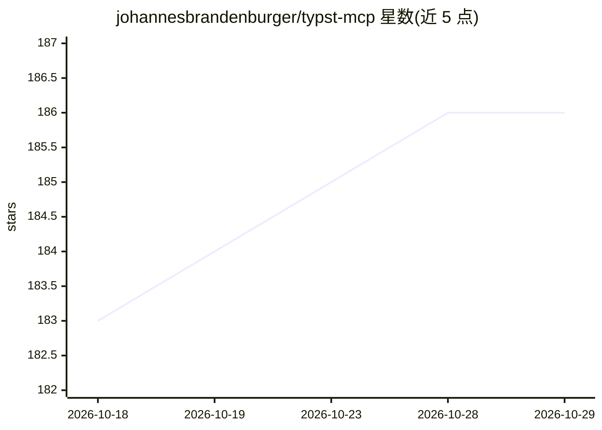

# johannesbrandenburger/typst-mcp

⭐ 186 · Python · MIT · 推送 2026-04-18 · [GitHub](https://github.com/johannesbrandenburger/typst-mcp) · 个人维护

**让 AI 模型操作 Typst 排版的 MCP 服务器**

基于 Model Context Protocol 的服务器，向 AI 模型提供 5 组工具：列出并读取 Typst 文档章节、经 Pandoc 将 LaTeX 代码转换为 Typst、校验 Typst 语法、将 Typst 代码渲染为 PNG 图片。安装需克隆本仓库与 typst 仓库并用 cargo 生成文档 JSON，再以 uv sync 装依赖，python server.py 运行。提供 Claude Desktop、Cursor、Roo Code、OpenCode、Claude Code、VS Code Agent Mode 的接入配置说明，另有 Docker 构建（见 DOCKER.md）。限制：Typst 文档 schema 不稳定，可能随上游变更失效。

## 筛选速览

| 维度 | 判定 | 备注 |
|---|---|---|
| AI 角色 | `ai-ecosystem` | LLM/agent 周边工具 |
| 许可风险 | `permissive` | MIT |
| 部署形态 | `None` |  |
| 模型依赖 | locked-api |  |
| 硬件要求 | — | 无带数字的原话,不猜 |
| 安装摩擦 | `low` | 无编译、无系统依赖或容器化 |
| 成熟度 | — | 结构信号不足 |

## 能力要点

- LaTeX↔Typst 转换（基于 Pandoc）与 Typst 语法校验
- Typst 代码渲染为 PNG 供多模态模型检查
- Typst 文档章节的列表与读取工具
- 6 个 AI 编码平台的 MCP 接入配置说明

## 适用场景

- 在 Claude/Cursor 等 AI 编码助手中编写和校验 Typst 文档
- 把已有的 LaTeX 片段转成 Typst
- 让多模态模型预览 Typst 排版渲染结果

## 场景标签

 · 领域:LLM 工具服务/排版

## 证据(README 行号)

> L3: Typst MCP Server is an MCP (Model Context Protocol) implementation that helps AI models interact with Typst, a marku
> L19: 3. **`latex_snippet_to_typst(latex_snippet)`**: Converts LaTeX code to Typst using Pandoc.
> L27: 5. **`typst_to_image(typst_snippet)`**: Renders Typst code to a PNG image.

## 星数曲线

2026-10-18 183 → 2026-10-29 186（+3）

---
*卡片 v1 · prompt 1.4 · 生成 2026-10-23 · 置信度 high · 依据 README sha `7c28e26ef5da` · [字段定义](../../DATASET.md)*
