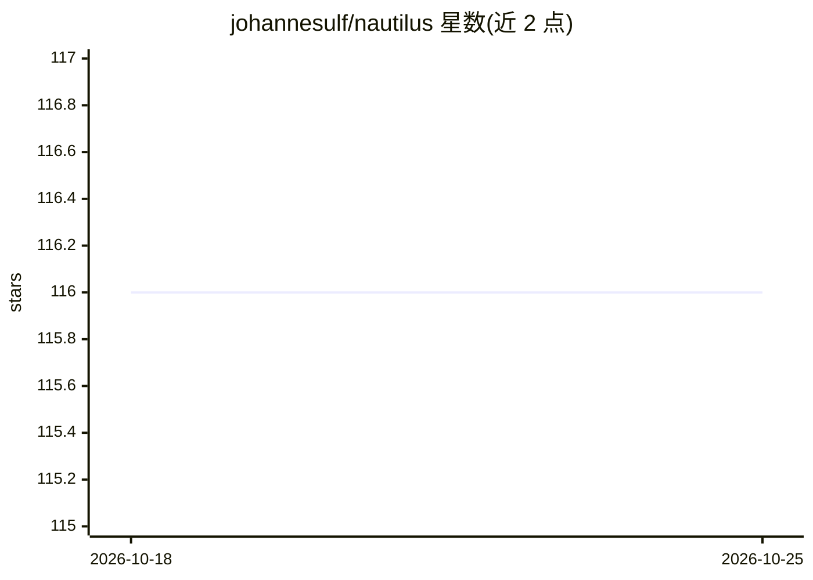

# johannesulf/nautilus

⭐ 116 · Python · MIT · 推送 2026-10-21 · [GitHub](https://github.com/johannesulf/nautilus) · [官网](https://nautilus-sampler.readthedocs.io) · 个人维护

**神经网络加速的贝叶斯后验与证据估计 Python 库**

纯 Python 实现的贝叶斯推断采样库，用重要性嵌套抽样与神经网络驱动的高效空间探索进行后验与证据估计。README 称相较传统 MCMC 和嵌套抽样代码通常需要更少的似然调用次数并产生更大的后验样本量，证据估计可达百分比精度，在天体物理研究中被广泛使用。提供 PyPI 与 conda-forge 两种安装途径，方法论文发表于 MNRAS 并有 arXiv 预印本。

## 筛选速览

| 维度 | 判定 | 备注 |
|---|---|---|
| AI 角色 | `ai-native` | 本体是模型或模型工具 |
| 许可风险 | `permissive` | MIT |
| 部署形态 | `library` | 以包/库形式分发 |
| 模型依赖 | — | README 未给出锁定关系 |
| 硬件要求 | — | 无带数字的原话,不猜 |
| 安装摩擦 | `low` | 无编译、无系统依赖或容器化 |
| 成熟度 | — | 结构信号不足 |

## 能力要点

- 神经网络驱动的高效参数空间探索
- 同时产出后验样本与贝叶斯证据估计
- MIT 许可的纯 Python 包，PyPI 与 conda-forge 均可安装
- 方法论文发表于 MNRAS（arXiv 有预印本）

## 适用场景

- 天体物理研究中的贝叶斯参数估计
- 需要证据估计的模型比较
- 似然调用开销大、希望减少调用次数的采样任务

## 场景标签

 · 领域:科学计算/贝叶斯统计

## 证据(README 行号)

> L13: Nautilus is an MIT-licensed pure-Python package for Bayesian posterior and evidence estimation. It utilizes importa
> L46: A paper describing nautilus's underlying methods and performance has been published in the Monthly Notices of the R

## 星数曲线

2026-10-18 116 → 2026-10-25 116（+0）

---
*卡片 v1 · prompt 1.4 · 生成 2026-10-23 · 置信度 high · 依据 README sha `d0aafdbe1a82` · [字段定义](../../DATASET.md)*
