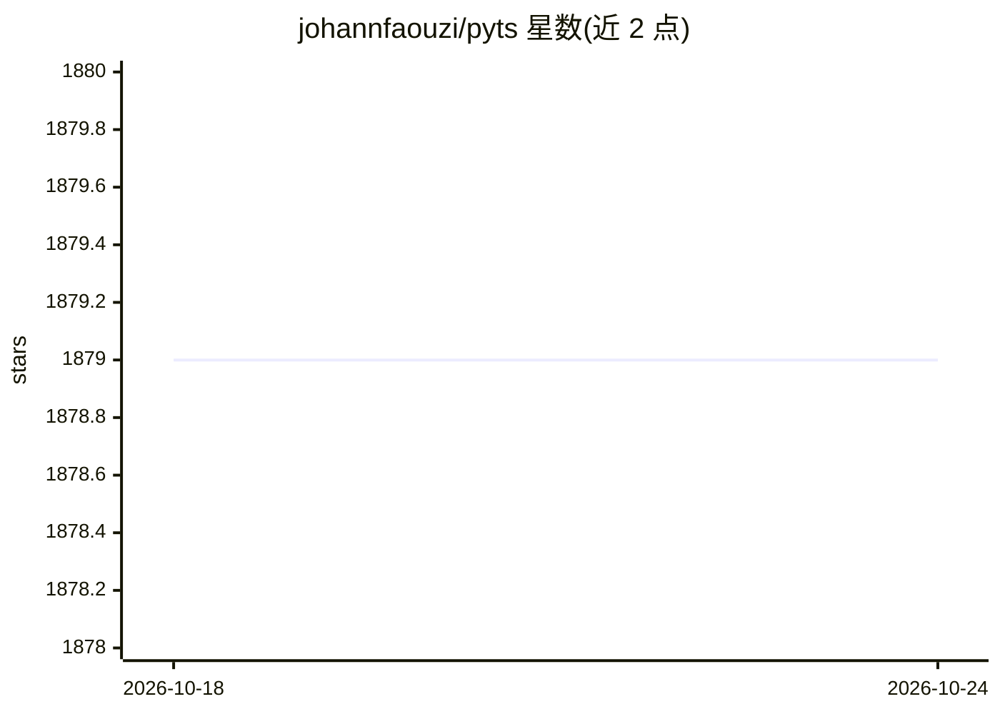

# johannfaouzi/pyts

⭐ 1,878 · Python · BSD-3-Clause · 推送 2026-10-21 · [GitHub](https://github.com/johannfaouzi/pyts) · [官网](https://pyts.readthedocs.io) · 个人维护

**时间序列分类的 Python 机器学习库**

pyts 是面向时间序列分类的 Python 包，提供预处理与实用工具及多种算法实现。功能按模块组织：近似（PAA/SAX/DFT/SFA）、词袋转换、分类器（BOSSVS、LearningShapelets、TimeSeriesForest 等）、时间序列转图像（递归图、格拉姆角场）、DTW 度量、多元时间序列工具（WEASEL+MUSE）及转换算法（BOSS、ROCKET 等）。可从 UEA & UCR 仓库获取数据集。依赖 NumPy/SciPy/scikit-learn/Joblib/Numba，通过 pip、conda 或源码安装，面向使用 scikit-learn 风格 API 的开发与科研用户。

## 筛选速览

| 维度 | 判定 | 备注 |
|---|---|---|
| AI 角色 | `ai-native` | 本体是模型或模型工具 |
| 许可风险 | `permissive` | BSD-3-Clause |
| 部署形态 | `library` | 以包/库形式分发 |
| 模型依赖 | — | README 未给出锁定关系 |
| 硬件要求 | — | 无带数字的原话,不猜 |
| 安装摩擦 | `low` | 无编译、无系统依赖或容器化 |
| 成熟度 | — | 结构信号不足 |

## 能力要点

- 六大类算法实现：近似、转换、分类、图像化、度量、分解
- 支持从 UEA & UCR 时间序列分类仓库获取数据集
- 多元时间序列的转换与分类工具（WEASEL+MUSE、JointRecurrencePlot）
- 与 scikit-learn 生态保持一致的 API 与开发流程

## 适用场景

- 用 BOSSVS、ROCKET 等算法对时间序列数据做分类
- 将时间序列转换为图像或词袋特征用于建模
- 复现时间序列分类研究并引用其 JMLR 论文

## 场景标签

 · 领域:机器学习/时间序列分析

## 证据(README 行号)

> L12: pyts is a Python package for time series classification. It
> L110: - `classification`: This module provides implementations of algorithms that

## 星数曲线

2026-10-18 1,879 → 2026-10-24 1,879（+0）

---
*卡片 v1 · prompt 1.4 · 生成 2026-10-21 · 置信度 high · 依据 README sha `4e79d36b4ddc` · [字段定义](../../DATASET.md)*
