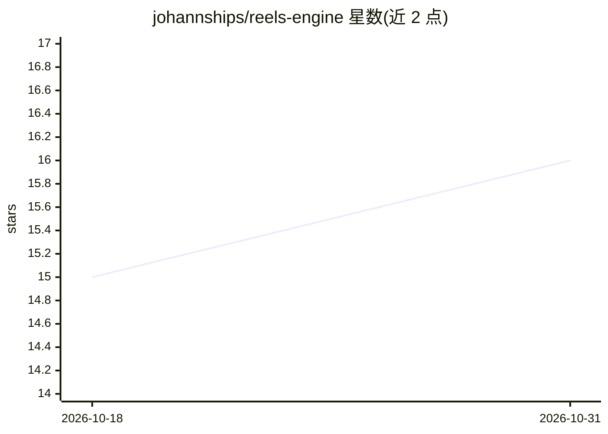

# johannships/reels-engine

⭐ 16 · TypeScript · MIT · 推送 2026-10-19 · [GitHub](https://github.com/johannships/reels-engine) · [官网](https://johann.fyi) · 个人维护

**用 AI agent 把真人原始素材自动剪辑成短视频的引擎**

面向个人创作者的短视频制作引擎：以 Claude Code 为宿主 agent，安装 edit-style 技能后对手机或 DJI Pocket 拍摄的原始素材做自动剪辑——布局按语句切换、抓取真实网页与官方 logo 作为素材、Whisper 逐词配字幕，并通过字幕同步、响度、黑帧、色域等多项 QA 门槛后才产出 final.mp4。仓库另含已标注为 legacy 的全自动管线（趋势调研→LLM 写稿→HeyGen 数字人→Remotion 图形→Telegram 审批发布）。需 ffmpeg、whisper.cpp、Node 20+、Python 3。

## 筛选速览

| 维度 | 判定 | 备注 |
|---|---|---|
| AI 角色 | `ai-native` | 本体是模型或模型工具 |
| 许可风险 | `permissive` | MIT |
| 部署形态 | `library` | 以包/库形式分发 |
| 模型依赖 | locked-api |  |
| 硬件要求 | — | 无带数字的原话,不猜 |
| 安装摩擦 | `medium` | 含编译或系统依赖之一 |
| 成熟度 | — | 结构信号不足 |

## 能力要点

- Claude Code 技能形式的一句式剪辑流程（edit this reel）
- 逐词字幕由 Whisper 在最终渲染上定时
- 多道 QA 门槛：字幕同步、音视频等长、响度、黑帧、BT.709 色域、数字来源核验
- 遗留全自动管线含 HeyGen 数字人克隆与 Metricool 多平台发布

## 适用场景

- 我拍了原始素材后让 agent 自动剪辑出带字幕和图形的短视频
- 为自己的频道搭建每日短视频自动化生产线（legacy 管线）
- 发布前用 QA 门槛自动检查字幕同步与画面合规

## 场景标签

`语音识别` `图像视频处理` · 领域:感知与多模态

## 证据(README 行号)

> L53: 3. **Say "edit this reel"** in Claude Code from that folder, with a line on
> L78: voice → HeyGen avatar clone → Remotion graphics + karaoke captions → a QA

## 星数曲线

2026-10-18 15 → 2026-10-31 16（+1）

---
*卡片 v1 · prompt 1.4 · 生成 2026-10-30 · 置信度 high · 依据 README sha `fb1f0aa6eb2e` · [字段定义](../../DATASET.md)*
