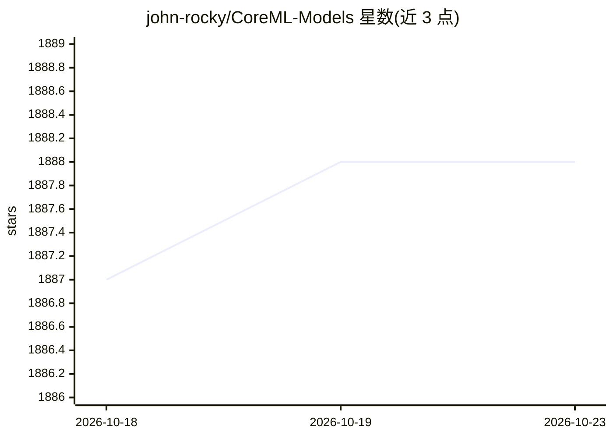

# john-rocky/CoreML-Models

⭐ 1,888 · Swift · 推送 2026-10-05 · [GitHub](https://github.com/john-rocky/CoreML-Models) · [官网](https://john-rocky.github.io/) · 个人维护

**iOS/macOS 的 Core ML 模型动物园：含转换脚本与示例 App**

由个人维护的 Core ML 模型目录：将 PyTorch 等来源的模型转换为可直接使用的 .mlpackage，条目按图像分类、目标检测（YOLO 系列）、分割、语音、视觉-语言等任务组织，每条列出 Google Drive 下载链接、模型大小、输出格式、原始项目与许可证，部分附带 SwiftUI 示例工程与 Colab 转换脚本。面向在 Apple 平台集成本地模型的开发者；模型许可证随各自原始项目，另有姊妹仓库覆盖 Core AI（iOS/macOS 27）与端侧 LLM。

## 筛选速览

| 维度 | 判定 | 备注 |
|---|---|---|
| AI 角色 | `ai-knowledge` | 知识聚合/清单类 |
| 许可风险 | `none` | — |
| 部署形态 | `None` |  |
| 模型依赖 | — | README 未给出锁定关系 |
| 硬件要求 | — | 无带数字的原话,不猜 |
| 安装摩擦 | `low` | 无编译、无系统依赖或容器化 |
| 成熟度 | — | 结构信号不足 |

## 能力要点

- 覆盖图像分类、目标检测、跟踪、分割、语音、TTS 等多任务类别的 Core ML 模型目录
- 每个条目提供下载链接、大小、输出张量格式、原始项目与许可证信息
- 部分模型附带转换脚本（Colab）与示例 App 工程
- ByteTrack 提供纯 Swift 端侧跟踪实现（无需下载模型）

## 适用场景

- 为 iOS/macOS 应用寻找可直接集成的 Core ML 模型
- 查看模型转换后的输出格式与输入约束再决定集成方式
- 通过示例工程学习 Core ML 模型在 Xcode 项目中的用法

## 场景标签

`精选清单` · 领域:学习与行业

## 证据(README 行号)

> L9: This repository provides Core ML models and sample apps. Use the catalog below for existing Core ML integrations, ea
> L100: You can get the model converted to CoreML format from the link of Google drive.

## 星数曲线

2026-10-18 1,887 → 2026-10-23 1,888（+1）

---
*卡片 v1 · prompt 1.4 · 生成 2026-10-21 · 置信度 high · 依据 README sha `f00b883bb347` · [字段定义](../../DATASET.md)*
