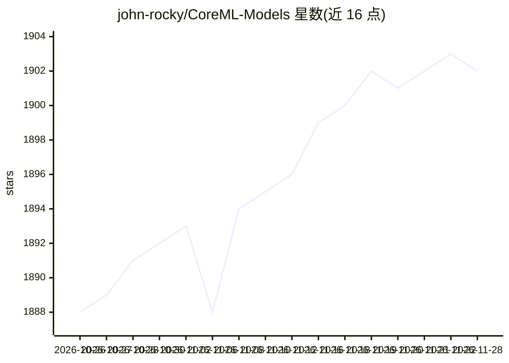

# john-rocky/CoreML-Models

⭐ 1,902 · Swift · Apache-2.0 · 推送 2026-11-19 · [GitHub](https://github.com/john-rocky/CoreML-Models) · [官网](https://john-rocky.github.io/) · 个人维护

**面向 iOS/macOS 开发者的 Core ML 模型库目录**

收录已转换为 Core ML（.mlpackage）格式的模型清单，覆盖图像分类、目标检测、分割、图像生成、修复、上色、人脸识别、语音分离、TTS、Stable Diffusion 等类别。每个条目提供 Google Drive 下载链接、模型大小、输出格式、原始项目与许可证信息，部分条目附 Colab 转换脚本与 SwiftUI 示例工程。模型许可遵循各自原始项目；README 未提供统一安装命令，模型按条目单独下载。

## 筛选速览

| 维度 | 判定 | 备注 |
|---|---|---|
| AI 角色 | `ai-knowledge` | 知识聚合/清单类 |
| 许可风险 | `permissive` | Apache-2.0 |
| 部署形态 | `None` |  |
| 模型依赖 | — | README 未给出锁定关系 |
| 硬件要求 | — | 无带数字的原话,不猜 |
| 安装摩擦 | `low` | 无编译、无系统依赖或容器化 |
| 成熟度 | — | 结构信号不足 |

## 能力要点

- 按任务类别组织的 Core ML 模型目录（检测、分割、生成、语音等）
- 每个模型附 Google Drive 下载链接与许可证来源标注
- 部分条目提供 Colab 转换脚本与 SwiftUI 示例工程
- 附带纯 Swift 实现的 ByteTrack 跟踪器，可叠加于检测结果

## 适用场景

- 为 iOS/macOS 应用寻找可直接打包的 Core ML 模型
- 参考示例工程学习模型在 Xcode 中的接入方式
- 用 Colab 转换脚本自行转换 PyTorch 模型

## 场景标签

`图像生成` `语音合成` `人脸识别` `图像视频处理` · 领域:内容生成

## 证据(README 行号)

> L13: Take a look this model zoo, and if you found the CoreML model you want,
> L100: You can get the model converted to CoreML format from the link of Google drive.

## 星数曲线

2026-10-26 1,888 → 2026-11-28 1,902（+14）

---
*卡片 v1 · prompt 1.4 · 生成 2026-11-23 · 置信度 high · 依据 README sha `60fd9b8787ab` · [字段定义](../../DATASET.md)*
