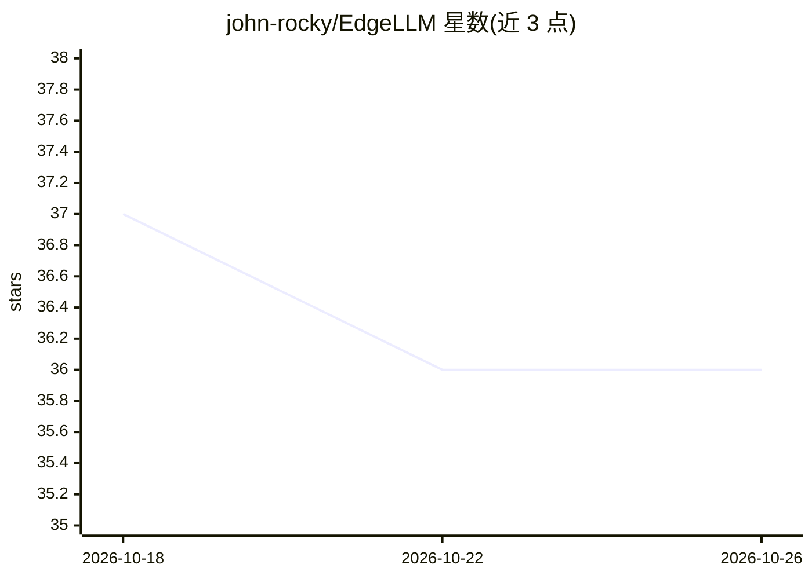

# john-rocky/EdgeLLM

⭐ 36 · Swift · Apache-2.0 · 推送 2026-05-28 · [GitHub](https://github.com/john-rocky/EdgeLLM) · [官网](https://john-rocky.github.io/) · 个人维护

**在 iOS 设备上本地运行 LLM 的 Swift 库**

基于 MLC-LLM 的 Swift 包，让 iOS/macOS/visionOS 应用以一行代码调用大语言模型：内置 Qwen 0.6B、Gemma 2B、Phi-3.5 Mini 三种模型（首次使用自动下载），支持流式输出、系统提示、多轮对话、SwiftUI Observable 封装与自定义 MLC 编译模型；推理通过 Metal GPU 加速、全部在设备端完成。面向希望在自己的 App 中集成离线 LLM 对话能力的 Swift/iOS 开发者。

## 筛选速览

| 维度 | 判定 | 备注 |
|---|---|---|
| AI 角色 | `ai-ecosystem` | LLM/agent 周边工具 |
| 许可风险 | `permissive` | Apache-2.0 |
| 部署形态 | `None` |  |
| 模型依赖 | — | README 未给出锁定关系 |
| 硬件要求 | — | 无带数字的原话,不猜 |
| 安装摩擦 | `low` | 无编译、无系统依赖或容器化 |
| 成熟度 | — | 结构信号不足 |

## 能力要点

- 一行代码调用本地 LLM，模型自动下载与缓存管理
- 支持流式 token 输出、系统提示、多轮对话与生成参数
- SwiftUI Observable 封装，可直接接入界面
- 可加载自定义 MLC 编译模型

## 适用场景

- 在我的 iOS App 里加入离线 AI 对话功能
- 在 iPhone 上本地运行 Qwen/Gemma/Phi-3 且数据不出设备
- 做一个带性能指标（tokens/sec、延迟）的流式聊天演示应用

## 场景标签

`推理引擎` · 领域:训练与推理

## 证据(README 行号)

> L12:  Run Large Language Models on iOS devices with just one line of code
> L232: EdgeLLM is built on top of the MLC-LLM project.
> L140: Bring your own MLC-compiled models when using a custom MLCRuntime binary:

## 星数曲线

2026-10-18 37 → 2026-10-26 36（-1）

---
*卡片 v1 · prompt 1.4 · 生成 2026-10-25 · 置信度 high · 依据 README sha `d86f6a4c1d69` · [字段定义](../../DATASET.md)*
