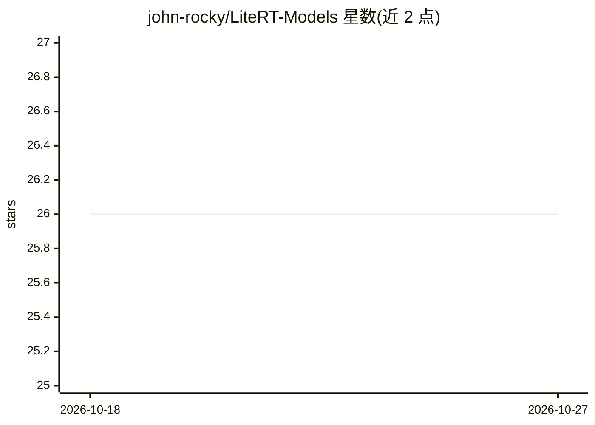

# john-rocky/LiteRT-Models

⭐ 26 · Kotlin · MIT · 推送 2026-10-25 · [GitHub](https://github.com/john-rocky/LiteRT-Models) · [官网](https://john-rocky.github.io/) · 个人维护

**Android 端侧 TFLite 模型库：91 个经 GPU 转换的 .tflite 模型**

面向 Android 开发者的转换模型库：收录 91 个由 PyTorch 经 Google litert-torch 转换的 .tflite 模型（截至 2026-09-08），覆盖目标检测、姿态估计、OCR、语音识别、TTS、LLM 对话等任务。每个模型附下载链接、输入输出形状、预处理说明、生成该模型的转换脚本与独立 Kotlin 示例应用。模型在手机 GPU 上通过 CompiledModel 全算子运行（无 CPU 回退），聊天模型运行于 LiteRT-LM；GPU 兼容性改写收录在转换指南与 litert_gpu_toolkit 中。不使用 MediaPipe 与厂商 SDK。表中给出各机型实测延迟。

## 筛选速览

| 维度 | 判定 | 备注 |
|---|---|---|
| AI 角色 | `ai-knowledge` | 知识聚合/清单类 |
| 许可风险 | `permissive` | MIT |
| 部署形态 | `library` | 以包/库形式分发 |
| 模型依赖 | — | README 未给出锁定关系 |
| 硬件要求 | — | 无带数字的原话,不猜 |
| 安装摩擦 | `low` | 无编译、无系统依赖或容器化 |
| 成熟度 | — | 结构信号不足 |

## 能力要点

- 91 个 PyTorch→.tflite 转换模型，附转换脚本与 Kotlin 示例应用
- CompiledModel GPU 全算子委托运行，无 CPU 回退，不依赖 MediaPipe 与厂商 SDK
- 覆盖检测/分割/姿态/OCR/TTS/ASR/嵌入/LLM 对话等多类任务
- 提供 GPU 兼容性改写的转换指南与 litert_gpu_toolkit

## 适用场景

- 查找可在 Android GPU 上直接运行的端侧模型并获取延迟参考
- 参照转换脚本与指南把自己的 PyTorch 模型转到 .tflite GPU 路径
- 用现成 Kotlin 示例应用快速验证某模型在目标机型上的表现

## 场景标签

`目标检测` `OCR` `语音识别` `语音合成` · 领域:内容生成

## 证据(README 行号)

> L3: LiteRT is Google's on-device ML runtime for Android and the successor to TensorFlow Lite (renamed 2024-09): PyTorch 
> L5: This repository is the model zoo for that path: **91 converted models** (as of 2026-09-08), each with its download, 

## 星数曲线

2026-10-18 26 → 2026-10-27 26（+0）

---
*卡片 v1 · prompt 1.4 · 生成 2026-10-26 · 置信度 low · 依据 README sha `df8a91b891ac` · [字段定义](../../DATASET.md)*
