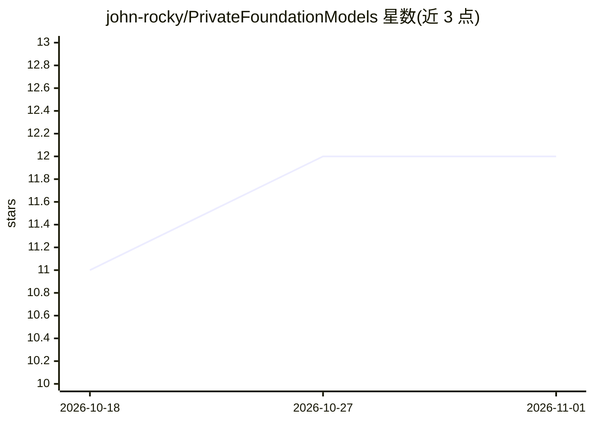

# john-rocky/PrivateFoundationModels

⭐ 12 · Swift · NOASSERTION · 推送 2026-05-14 · [GitHub](https://github.com/john-rocky/PrivateFoundationModels) · [官网](https://john-rocky.github.io/) · 个人维护

**iOS 开发者的 Apple FoundationModels 兼容 Swift 库，多后端同调用点**

Swift 软件包，镜像 Apple FoundationModels API（LanguageModelSession、@Generable、Tool 等），使同一套调用代码可运行于三种端侧后端：iOS 26 原生 Apple Intelligence 透传、iOS 18+ 的 CoreML/神经引擎（LFM2.5、Gemma、Qwen 等）、iOS 17+ 的 MLX/GPU（任意 mlx-community 模型）。另提供 OpenAI 兼容本地 HTTP 服务（chat/completions/embeddings、SSE 流式、多模型加载），支持 LoRA/DoRA 适配器与自带后端扩展。以 SPM 安装，模型文件首次调用时下载。非 Apple 官方产品；CoreML/MLX 上不做语法约束采样，@Generable 靠提示词+后处理实现。

## 筛选速览

| 维度 | 判定 | 备注 |
|---|---|---|
| AI 角色 | `ai-ecosystem` | LLM/agent 周边工具 |
| 许可风险 | `permissive` | NOASSERTION |
| 部署形态 | `None` |  |
| 模型依赖 | — | README 未给出锁定关系 |
| 硬件要求 | — | 无带数字的原话,不猜 |
| 安装摩擦 | `medium` | 含编译或系统依赖之一 |
| 成熟度 | — | 结构信号不足 |

## 能力要点

- 同一 LanguageModelSession 调用点覆盖 Apple FM / CoreML / MLX 三种后端
- OpenAI 兼容本地 HTTP API（流式、工具调用、视觉、embeddings、多模型加载）
- 支持自带 LoRA/DoRA 微调适配器，MLX 后端内存中直接应用
- 94/94 单元测试及多套真机验证流程记录于 README

## 适用场景

- 应用需在 iOS 18 上提前用上 FoundationModels 风格 API
- 在 Apple 设备上运行自带的开源模型（Qwen/Gemma/Llama 等）
- 让 Python/Node 等非 Swift 代码通过 OpenAI 协议调用 Apple 端侧模型
- 对比 CoreML/MLX/Apple FM 三个运行时的性能

## 场景标签

`推理引擎` · 领域:训练与推理

## 证据(README 行号)

> L43: PFM is the **iOS 18 polyfill that becomes a runtime passthrough on iOS 26**. The same Apple-FM-shaped code compiles
> L45: |Backend|Product|iOS|Model|

## 星数曲线

2026-10-18 11 → 2026-11-01 12（+1）

---
*卡片 v1 · prompt 1.4 · 生成 2026-11-01 · 置信度 high · 依据 README sha `570a7da8e237` · [字段定义](../../DATASET.md)*
