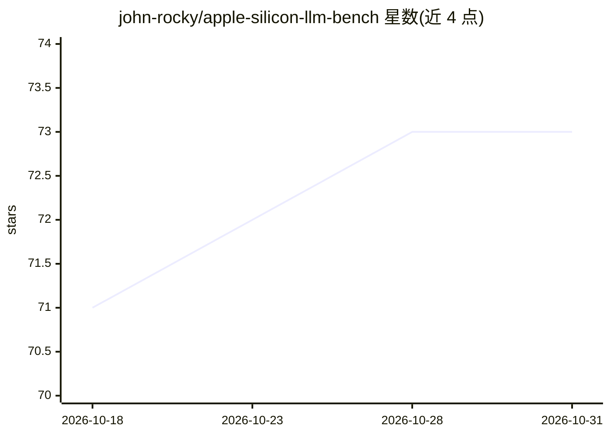

# john-rocky/apple-silicon-llm-bench

⭐ 73 · Python · MIT · 推送 2026-10-18 · [GitHub](https://github.com/john-rocky/apple-silicon-llm-bench) · [官网](https://john-rocky.github.io/) · 个人维护

**Apple Silicon 端侧 LLM 运行时性能基准：同模型同测试协议对比多引擎**

在 iPhone 17 Pro、Mac Studio (M4 Max) 等 Apple Silicon 设备上，对 Apple Core AI、MLX、llama.cpp、LiteRT-LM、Core ML 等引擎运行同一模型的可复现基准：使用仓库内置 harness（统一 prompt 与 token 预算）记录 decode tok/s、prefill、TTFT、内存与 GSM8K，每个数字附量化方案与采集会话；另含混合 Mamba-2 模型（Nemotron-3 Nano、Granite-4.0-H、Falcon-H1）的 CLI 测试。明确禁止跨会话比值比较。给选型端侧推理方案的开发者与研究者使用。

## 筛选速览

| 维度 | 判定 | 备注 |
|---|---|---|
| AI 角色 | `ai-ecosystem` | LLM/agent 周边工具 |
| 许可风险 | `permissive` | MIT |
| 部署形态 | `None` |  |
| 模型依赖 | local-ok | 支持本地模型 |
| 硬件要求 | — | 无带数字的原话,不猜 |
| 安装摩擦 | `medium` | 含编译或系统依赖之一 |
| 成熟度 | — | 结构信号不足 |

## 能力要点

- 同一模型与 harness 下对比 Core AI / MLX / llama.cpp / LiteRT-LM / Core ML
- 每个数字附量化方案与采集会话记录（results/ 与 RESULTS.md）
- 覆盖 iPhone 17 Pro 与 M4 Max 真实设备约束下的冷/热启动与内存数据
- 包含 Nemotron-3 Nano、Granite-4.0-H、Falcon-H1 等混合 Mamba-2 模型测试

## 适用场景

- 为 iOS/macOS 应用选择端侧 LLM 推理引擎时查看实测数据
- 比较不同量化方案在同一设备上的 tok/s 与内存占用
- 追踪 Apple Core AI（Core ML 后继）与 MLX 的端侧表现

## 场景标签

`模型评测` · 领域:评测与运维

## 证据(README 行号)

> L79: **On-device LLM benchmark for Apple Silicon — iPhone · iPad · Mac.**
> L81: A neutral, reproducible benchmark for running local LLMs (and, in time, ASR / TTS) on Apple Silicon. Compares **MLX

## 星数曲线

2026-10-18 71 → 2026-10-31 73（+2）

---
*卡片 v1 · prompt 1.4 · 生成 2026-10-24 · 置信度 high · 依据 README sha `1a0177130f51` · [字段定义](../../DATASET.md)*
