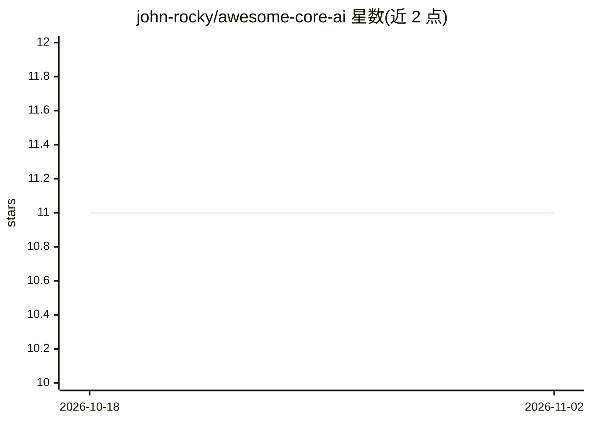

# john-rocky/awesome-core-ai

⭐ 11 · Python · 推送 2026-10-26 · [GitHub](https://github.com/john-rocky/awesome-core-ai) · [官网](https://john-rocky.github.io/core-ai/) · 个人维护

**Apple Core AI 框架资源策展清单：文档、模型、工具与教程**

面向 iOS 27 / macOS 27 开发者的 Core AI 资源聚合清单：收录 Apple 官方仓库（模型导出、PyTorch 转换、量化压缩）、Swift 包与示例应用（聊天、视觉、语音）、可下载模型 zoo 与转换工具链（ONNX/MLX/TorchConverter）、本地推理服务器、设备实测基准与工程笔记，以及入门书籍与 WWDC26 会话链接。条目按任务路由组织（试用模型/集成到 Swift 应用/转换自有模型），各链接项目自带其模型、设备与工具链要求。清单按有用性排序而非作者身份。

## 筛选速览

| 维度 | 判定 | 备注 |
|---|---|---|
| AI 角色 | `ai-knowledge` | 知识聚合/清单类 |
| 许可风险 | `none` | — |
| 部署形态 | `None` |  |
| 模型依赖 | — | README 未给出锁定关系 |
| 硬件要求 | — | 无带数字的原话,不猜 |
| 安装摩擦 | `low` | 无编译、无系统依赖或容器化 |
| 成熟度 | — | 结构信号不足 |

## 能力要点

- 覆盖官方工具、模型转换、Swift 包、示例应用与基准的资源清单
- 按任务路由组织：试用模型、集成到 Swift 应用、选择/转换模型
- 收录设备实测基准（iPhone 17 Pro GPU/ANE、M4 Max 的 tok/s）与工程笔记
- 包含 Serving 部分：Core AI 本地推理服务器与 OpenAI/Anthropic 兼容 API

## 适用场景

- 在 Swift/iOS 应用中集成 Core AI 本地模型时查找工具与示例
- 把 PyTorch/ONNX/MLX 模型转换为 .aimodel 格式时寻找转换路径
- 了解 Core AI 与 MLX、ANE/GPU 的实测性能对比
- 系统学习 Apple 端侧 AI 开发（书籍、WWDC 会话、实验课程）

## 场景标签

`精选清单` · 领域:学习与行业

## 证据(README 行号)

> L3: > Curated resources for Apple's **Core AI** framework (iOS 27 / macOS 27+) — official tooling,
> L6: Need to try a local model, add one to a Swift app, or convert your own? Start with the route below. Core AI uses `.a
> L23: ## Contents

## 星数曲线

2026-10-18 11 → 2026-11-02 11（+0）

---
*卡片 v1 · prompt 1.4 · 生成 2026-11-02 · 置信度 high · 依据 README sha `cd8e2158a02a` · [字段定义](../../DATASET.md)*
